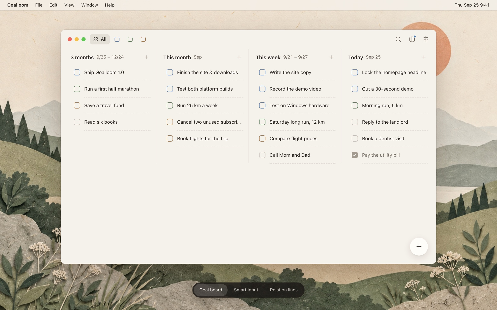

<p align="center">
  
</p>

<h1 align="center">Goalloom</h1>

<p align="center"><strong>Connect a quarter's direction to today's to-dos.</strong></p>

<p align="center">
  Goalloom is an open-source, local-first to-do app for macOS and Windows, built around OKRs.<br>
  Time columns answer <em>when</em>; goal links answer <em>why</em>—so the goals that matter stop losing to whatever feels urgent.
</p>

<p align="center">
  <a href="https://github.com/thinkingjimmy/goalloom/releases/latest"></a>
  <a href="https://github.com/thinkingjimmy/goalloom/stargazers"></a>
  <a href="./LICENSE"></a>
</p>

<p align="center">
  <a href="https://www.goalloom.com">Website</a> ·
  <a href="https://github.com/thinkingjimmy/goalloom/releases/latest">Download</a> ·
  <a href="./docs/development.md">Development</a> ·
  <a href="./docs/features/">Feature specs</a> ·
  <a href="https://x.com/hellojimmywong">X</a>
</p>

<p align="center">
  <strong>English</strong> | <a href="./docs/README.zh-CN.md">简体中文</a>
</p>

<p align="center">
  
</p>

# Key features

- **Goals and today on one board.** Four time columns—3 months, this month, this week, today—put the quarter's goals beside today's work. A collapsible Later sidebar keeps unplanned ideas close at hand.
- **Two task levels, complete tasks.** Drag a task onto another, or press Tab in inline entry or the board title editor, to indent it. Shift+Tab makes it independent. Subtasks inherit goals and colors and keep their own details and status. Reschedule them independently; moving a parent carries only children scheduled with it.
- **Every to-do knows why.** Link an item to goals in longer horizons. Filter one goal (⌘1–⌘9) and relation lines draw its whole chain; hover any row to light its path. Links explain, they never roll up progress.
- **Write it down; Jev places it.** Optional Jev 1.14 smart input matches new tasks to your goals from Cmd+N and inline column entry. Enter saves immediately; a late answer can fill the column and parents. Manual edits win, and creation plus its automatic completion remains one undo step. Bring your own key.
- **Nothing slips quietly.** Unfinished items roll over to the next period, and past periods stay readable and can be cleared in batches.
- **Undo anything, lose nothing.** Every change can be undone without touching your later edits; daily backups, plus safe restore and reset with a protective copy first.
- **Local-first and private.** Your workspace is a SQLite database on your computer, with no content telemetry. Optional sync encrypts data before it leaves your device.
- **Made for the keyboard, in five languages.** ⌘N to capture, ⌘K to search, ⌘Z to undo. Chinese, English, Japanese, Spanish and French; paper, minimal or macOS 27 style, light or dark.

# Get started

## Download

[Download the latest release →](https://github.com/thinkingjimmy/goalloom/releases/latest)

| Platform | Download |
| --- | --- |
| macOS 14+ (Apple silicon) | `Goalloom-<version>-mac-arm64.dmg` |
| Windows 11 (x64) | `Goalloom-<version>-win-x64.exe` |

The macOS build is **Developer ID signed and notarized by Apple**. The Windows installer is **not code-signed**.

**macOS.** Open the DMG, drag Goalloom into `Applications`, then open it.

**Upgrading from the published macOS 1.8.0 build:** quit Goalloom and replace it with 1.9.10 in `Applications` once. Its old ad-hoc signature cannot use the new Developer ID update. Your workspace and settings are kept.

**Windows.** SmartScreen shows "Windows protected your PC". Choose **More info**, then **Run anyway**, and follow the installer.

Your workspace lives in `~/Library/Application Support/Goalloom/` (macOS) or `%APPDATA%\Goalloom\` (Windows), with daily backups in `backups/`. Installing a newer version keeps it.

## Build from source

Requires Node.js 22.12 or newer and pnpm 11.9 (pinned in `package.json`; Corepack enables it).

```bash
git clone https://github.com/thinkingjimmy/goalloom.git
cd goalloom
corepack enable
pnpm install --frozen-lockfile
pnpm dev
```

To build local installers:

```bash
pnpm package:mac   # apps/desktop/release/Goalloom-<version>-mac-arm64.dmg
pnpm package:win   # apps/desktop/release/Goalloom-<version>-win-x64.exe
```

Version 1.9.8 separates production sync from development. Local tasks, history and calendar stay in place, with a protective backup before transition. Sign in to Google again and set a sync password to upload to the new production workspace. Update every computer using sync to 1.9.10. Current source uses workspace format v12 for the macOS 27 appearance; published 1.9.10 uses v11. See the [1.9.10 release notes](./docs/releases/v1.9.10.md). Build-time configuration is in the [development guide](./docs/development.md).

The [development guide](./docs/development.md) (Chinese) covers the full test suite, packaging checks, the repository map and the rules for contributors and coding agents. The marketing site lives in [`apps/website/`](./apps/website/README.md).

Current source supports desktop Apple/Google sign-in through Supabase PKCE and native iOS provider adapters with protected session storage. Current source also includes the [authenticated hosted AI transport](./docs/features/hosted-ai.md), with account-only login and server cost protection; development Auth and synthetic live-model acceptance are recorded in its feature contract. Encrypted mobile workspace sync is pending its next milestone. See the [mobile configuration and acceptance guide](./apps/mobile/README.md#native-account-configuration).

# Collaboration

Please use [GitHub Issues](https://github.com/thinkingjimmy/goalloom/issues) for bugs, feedback and proposals.

# License

The desktop app, the mobile client, and the shared packages are [MIT](./LICENSE). Server-side sync code is [GNU AGPL-3.0-only](./supabase/LICENSE).

| Path | License |
|---|---|
| [`LICENSE`](./LICENSE), `apps/desktop/` (app, tests, and desktop scripts), `apps/mobile`, `packages/` (including `packages/crypto/test` and `packages/tests`), `scripts/`, `apps/website/`, `docs/` | MIT |
| [`supabase/`](./supabase/) (migrations, RPCs, Edge Functions, pgTAP, `reset.sql`, `config.toml`, and [`supabase/LICENSE`](./supabase/LICENSE)) | AGPL-3.0-only |

`@goalloom/contracts`, `@goalloom/crypto`, `@goalloom/schema`, `@goalloom/store-core`, and `@goalloom/sync` depend only on each other and their pinned MIT-compatible libraries. Their sources stay under the repository MIT license. `scripts/supabase-remote.mjs`, `scripts/pg-sync-test.mjs`, `scripts/phase0-prototype.mjs` and `scripts/parity-digest.mjs` are MIT test clients.
