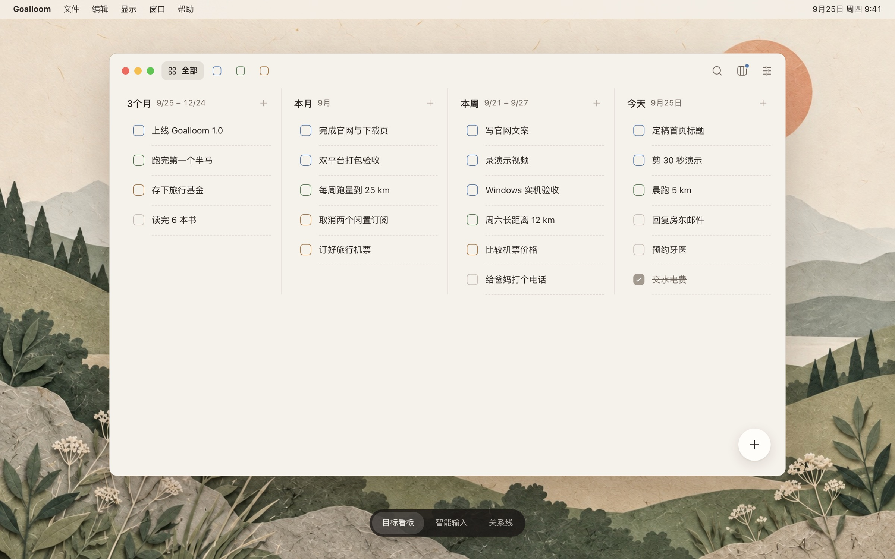

<p align="center">
  
</p>

<h1 align="center">Goalloom</h1>

<p align="center"><strong>把三个月的方向，连接到今天的行动。</strong></p>

<p align="center">
  Goalloom 是一款以 OKR 理念驱动、开源、本地优先的 Todo 应用，支持 macOS 与 Windows。<br>
  时间列回答「什么时候做」，关联回答「为什么做」——重要但不紧急的目标，不再被每天的急事淹没。
</p>

<p align="center">
  <a href="https://github.com/thinkingjimmy/goalloom/releases/latest"></a>
  <a href="https://github.com/thinkingjimmy/goalloom/stargazers"></a>
  <a href="../LICENSE"></a>
</p>

<p align="center">
  <a href="https://www.goalloom.com/zh-CN/">官网</a> ·
  <a href="https://github.com/thinkingjimmy/goalloom/releases/latest">下载</a> ·
  <a href="./development.md">开发文档</a> ·
  <a href="./features/">功能规格</a> ·
  <a href="https://x.com/thinkingjimmy">X</a>
</p>

<p align="center">
  <a href="../README.md">English</a> | <strong>简体中文</strong>
</p>

<p align="center">
  
</p>

# 核心功能

- **目标和今天，在同一块看板上。** 四个时间列——3个月、本月、本周、今天——让季度目标就摆在今天要做的事旁边；可收起的 Later 侧栏暂存尚未安排的想法。
- **每件事都知道自己为了什么。** 把事项挂在更长周期的目标下。筛选一个目标（⌘1–⌘9），关系线会把它的整条链路连起来；悬停任意一行，就能看到它的上下游。关联只解释「为什么」，不汇总进度。
- **随手记下，Jev 帮你归位。** 可选的智能输入会参考你的目标和历史 Todo，把新事项放进合适的时间列，并推荐它属于哪个目标。创建前可预览、可修改，整批一步撤销。使用你自己的密钥（BYOK）。
- **没有事会悄悄溜走。** 到期未完成的事项自动顺延到下一个周期，往期记录随时可读，也能批量处理。
- **每一步都能撤销，数据不会丢。** 每次改动都能单独撤销，不影响你之后的编辑；每日自动备份，恢复或重置前先留保护副本。
- **本地优先，保护隐私。** 工作区是你电脑上的 SQLite 数据库，没有内容遥测。可选同步会在数据离开设备前加密。
- **为键盘而生，支持五种语言。** ⌘N 新建、⌘K 搜索、⌘Z 撤销。界面支持中文、英文、日文、西班牙文和法文；纸感或简约风格，浅色或深色。

# 开始使用

## 下载

[下载最新版本 →](https://github.com/thinkingjimmy/goalloom/releases/latest)

| 平台 | 安装包 |
| --- | --- |
| macOS 14+（Apple 芯片） | `Goalloom-<版本>-mac-arm64.dmg` |
| Windows 11（x64） | `Goalloom-<版本>-win-x64.exe` |

## 首次打开

macOS 安装包已通过 Developer ID 签名和 Apple 公证。Windows 版仍未签名。

**macOS。** 打开 DMG，把 Goalloom 拖进「应用程序」后打开即可。

**从公开版 macOS 1.8.0 升级：** 退出 Goalloom，用 1.9.1 替换「应用程序」中的旧版一次。旧版的 ad-hoc 签名无法通过内置更新切换到本次 Developer ID 签名，工作区和设置会保留。

**Windows。** 出现 SmartScreen「Windows 已保护你的电脑」时，点「更多信息 → 仍要运行」，再按安装向导完成。

工作区位于 `~/Library/Application Support/Goalloom/`（macOS）或 `%APPDATA%\Goalloom\`（Windows），每日备份在其中的 `backups/`。覆盖安装新版本会保留原有数据。

## 从源码构建

需要 Node.js 22.12 及以上与 pnpm 11.9（已在 `package.json` 中锁定，可由 Corepack 启用）。

```bash
git clone https://github.com/thinkingjimmy/goalloom.git
cd goalloom
corepack enable
pnpm install --frozen-lockfile
pnpm dev
```

打本地安装包：

```bash
pnpm package:mac   # apps/desktop/release/Goalloom-<版本>-mac-arm64.dmg
pnpm package:win   # apps/desktop/release/Goalloom-<版本>-win-x64.exe
```

1.9.1 修复重复目标关联阻断同步的问题，并让未使用的同步按需访问钥匙串。用 Google 登录并设置同步密码，即可使用加密同步。说明见 [v1.9.1 发布说明](./releases/v1.9.1.md)。构建期的同步配置见[开发文档](./development.md)。

完整测试、打包检查、代码地图以及贡献者与开发代理的约定见[开发文档](./development.md)。官网代码在 [`apps/website/`](../apps/website/README.md)。

# 协作

问题、反馈和建议请提交到 [GitHub Issues](https://github.com/thinkingjimmy/goalloom/issues)。

# 许可证

桌面端、移动端和共享包使用 [MIT 许可证](../LICENSE)。服务端同步代码使用 [GNU AGPL-3.0-only](../supabase/LICENSE)。

| 路径 | 许可证 |
|---|---|
| [`LICENSE`](../LICENSE)、`apps/desktop/`（应用、测试与桌面脚本）、`apps/mobile`、`packages/`（含 `packages/crypto/test` 与 `packages/tests`）、`scripts/`、`apps/website/`、`docs/` | MIT |
| [`supabase/`](../supabase/)（迁移、RPC、Edge Functions、pgTAP、`reset.sql`、`config.toml`，以及 [`supabase/LICENSE`](../supabase/LICENSE)） | AGPL-3.0-only |

`@goalloom/contracts`、`@goalloom/crypto`、`@goalloom/schema`、`@goalloom/store-core` 和 `@goalloom/sync` 只依赖彼此及其已固定的库，源码仍属仓库 MIT 许可证。`scripts/supabase-remote.mjs` 与 `scripts/pg-sync-test.mjs` 是 MIT 测试客户端。
