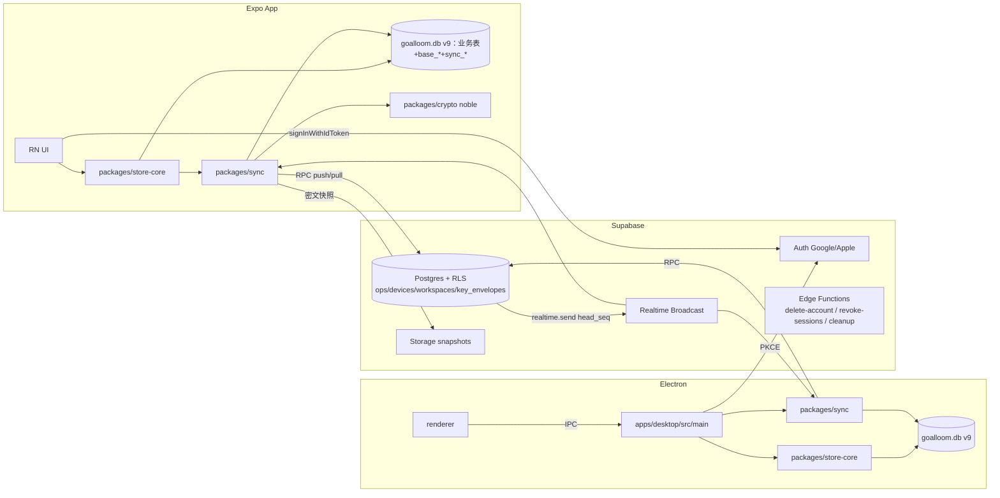
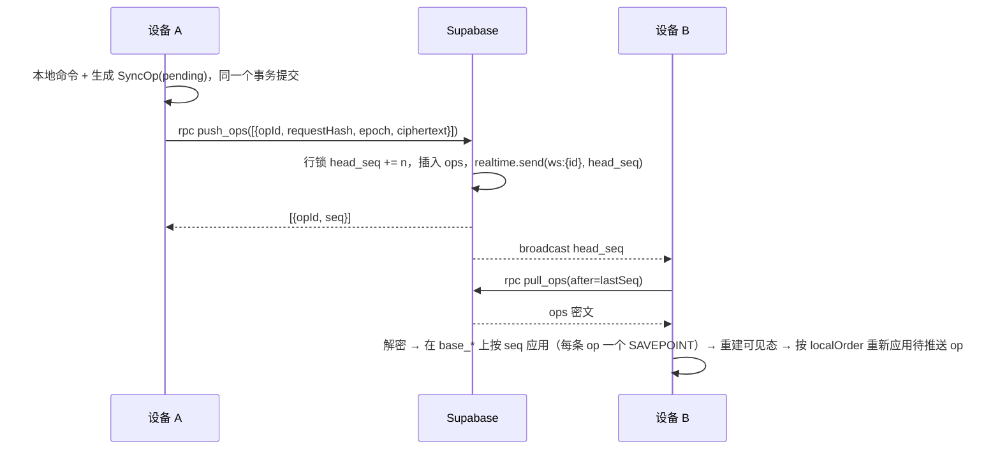
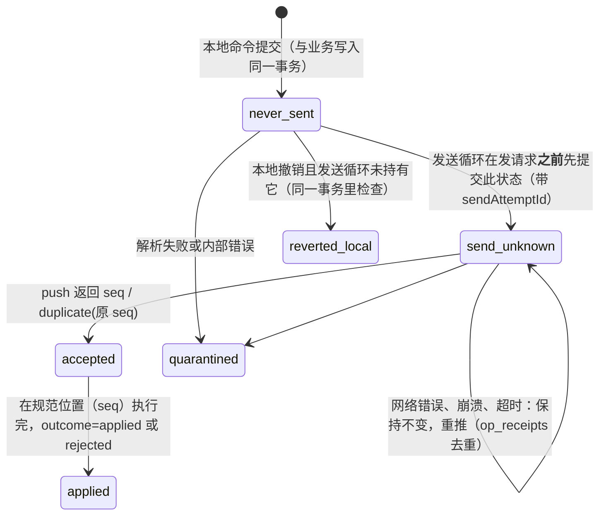

# Goalloom 移动版需求与实施文档（PRD + 技术实施）v1.4.1

> 日期：2026-10-11（UTC+8）。负责人：Jimmy Wong。依据：只读查看仓库 `thinkingjimmy/goalloom` main@`dd29236`。上一版保存在 `goalloom-mobile-prd-v1.0.md`。
> v1.1 根据同事评审（P0-01~P0-09 及其他意见）**重写了第 7、8、9、12、14 节**，评审意见的逐条处理见第 17 节。
> 标记说明：**【实证】** 表示已读到代码或官方文档；**【未核实】** 表示需要实施者确认；**【决策】** 表示已经拍板。
> **v1.2（2026-10-11）**：关闭了 session_id 的未知项，写入了经过实测的 Supabase SQL，更新了撤销和 Realtime 的设计，见文末的变更记录。
> v1.1 补充（2026-10-11 实测）：影子基线的 P0 spike 已经在 M3 Max 上跑完，结果写在 8.3.1；7.2、8.3、11、16 节也相应做了修正。
> **排期状态：在第 0 阶段交付协议规格并做出原型之前，第 14 节的所有工期都是"未验证的估算"。**

---

## 0. 一页摘要
- **做什么**：做一个功能完整的 Expo 移动端（iOS/Android），并给桌面端（Electron）和移动端加上端到端加密的多设备同步。
- **后端**【决策】：只用 Supabase。
  - 登录：Auth，只支持 Google 和 Apple。
  - 存储：Postgres 存密文 op 日志，每个工作区用行锁计数器分配无空洞序号；推送和拉取都通过 RPC。
  - 通知：Realtime 私有频道，只广播最新序号。
  - 快照：放 Storage。
  - Edge Functions：只用于删除账号、下线会话和清理。
- **本地**【决策，v1.1 修订】：仍然用 SQLite，**新增 v9 迁移**（v1.3：业务表尽量保持兼容；为规范历史和投影正确性所需的迁移允许做，前提是升级前自动备份并有回归测试）。同步用的源记录（op 信封、生命周期、基线游标）和业务写入**放在同一个数据库的同一个事务里**，不再使用附属库 sync.db（理由见 7.1）。
- **同步协议**【决策，v1.1 新增】：
  - 新增版本化的 **SyncOp 格式**，只携带改动的字段和业务意图，**不再重放现有的 commandSchema 命令**。
  - 用**影子重执行**维护规范基线：确认态 = 按 seq 依次应用服务端 op；可见态 = 确认态 + 按 localOrder 重新应用本地待推送的 op。v1.3：先实现全量参考 rebase，增量版必须与之差异校验；发送状态持久化；历史以 canon_ops/canon_changes 为准。
- **安全**【决策，v1.1 修订】：
  - 强制端到端加密。
  - **设备分状态管理**：registered → pending → authorized → revoked。可信设备名单要由已授权设备用 Ed25519 签名。
  - **恢复用公钥方案**：由 24 词派生出一对 X25519 恢复密钥，公钥存在服务端，私钥只在恢复时临时派生。
  - 扫码配对使用一次性、会过期的请求；v1.3：新设备的信任锚来自老设备二维码里的名单指纹或恢复公钥，不信任服务端给的自签链。
  - 撤销设备要在 RPC、表、Storage、Realtime 四个通道上一致生效。
- **冲突处理**：
  - 以服务端顺序为准，字段级后写胜出。
  - 修改会留下历史，可以撤销。
  - 业务冲突时整条 op 回滚、记一个稳定错误码，然后继续同步。
  - 自动顺延按"每个 item 的一次迁移"生成确定性 opId。
  - v1 的富文本整段后写胜出。
- **AI**：用户自带 Key，存在 secure-store。托管代理以后再做，而且**不在端到端加密的承诺范围内**。
- **收费**【决策，延后实现】：以后用 RevenueCat。桌面和 PC 先走网页支付；移动端只遵守服务端已有资格。`sync_entitled` 在 `public.entitlements` 出现之前返回 true。见第 15 节，待办 BILL-1 未勾选。
- 不考虑中国大陆。

### 0.1 本版已关闭的核实项【实证 @dd29236】
| 问题 | 结论 | 出处 |
|---|---|---|
| operations 里有没有完整的命令入参 | **没有**。只存了 `requestHash = sha256(JSON.stringify(command))`、kind、effects、result | `apps/desktop/src/main/workspace/repository.ts` 第 44–61 行 |
| `edit` 命令的字段 | 必须同时带 title、description、dueDate 三个字段（全量覆盖） | `apps/desktop/src/shared/contracts/commands.ts` 第 58 行；`commands/items.ts` 中 `editItem` 第 71–72 行 |
| item_events 和 effects 能否用来还原状态 | 不能。`businessState()` 只有状态、时间、placement、version，**不含 title 和 dueDate**；effects 只有 description 带正文 | `apps/desktop/src/shared/contracts/effects.ts` 第 17–41 行 |
| create / createPlan 的 id 从哪来 | 执行时用 `randomUUID()` 生成 | `commands/items.ts` 第 51 行；`commands/plan.ts` 第 44 行；关系 id 在 items.ts 第 139 行 |
| 自动顺延的写入路径 | `reconcile()` **绕过了** `Repository.execute()`：生成随机的 operationId，直接调用 `moveItem()`，写入 `kind:'rollover', source:'system'` 的 operation，requestHash 是 `sha256(generation:now:opId)`；同一事务里还会更新 clockAnomaly 和 lastObservedAt | `apps/desktop/src/main/workspace/reconcile.ts` 第 20–48 行 |
| 自定义 SQL 函数 | `store.ts` 用 `db.function()` 注册了 `guidance_signal` 和 `note_signal`；**expo-sqlite 没有提供注册 JS 自定义函数的 API** | `apps/desktop/src/main/storage/store.ts` 第 24–30 行；Expo SQLite 文档和 SQLiteDatabase.d.ts |
| 导入恢复会怎样 | `replaceDataset()` 会返回**一个新的 generation** | `apps/desktop/src/main/workspace/transfer/service.ts` 第 118 行 |
| 本地数据库的日志模式 | 开启了 WAL，`synchronous=FULL`，事务必须同步完成 | `apps/desktop/src/main/storage/database.ts` |
| SecureStore 有没有 2KB 上限 | v1.0 写成"约 2KB 上限"是**不准确的**。Expo 本身不强制限制；只是某些 iOS 版本曾经拒绝过约 2048 字节以上的值，所以需要处理原生层报错 | docs.expo.dev SecureStore（v57） |
| Realtime 的权限缓存 | 私有频道的权限按连接缓存，直到 JWT 过期或客户端发送新 token 才重新计算 | Supabase Realtime Authorization 文档 |
| signOut 能否让已签发的 JWT 失效 | 不能，已签发的 JWT 在过期前一直有效 | Supabase 官方在 GitHub issue #6702 中的回复 |
| 匿名公钥封装（sealed box 类构造）能否认证发送方 | 不能，它是匿名发送方加密；因此改用 C1（临时 X25519 加 Ed25519 签名，见 9.2） | libsodium 文档 "Sealed boxes"（只作为概念参考，实现不再使用 libsodium） |
| WAL 下跨附属库的提交 | 不是原子的 | SQLite 官方文档 lang_attach 和 atomic commit |

## 1. 背景
Goalloom 是一个本地优先的桌面规划工具，口号是"把三个月的方向，连接到今天的行动"。核心功能：
- 有六个时间跨度：年 / 半年 / 3 个月（cycle）/ 月 / 周 / 日，外加 Later（待定池）。
- 任务之间可以建立多父的关系（DAG），并按 Flow 着色。
- 有自动或手动顺延、Flow Insight、月度回顾、完整撤销、AI 智能输入和任务协助。

现在只有 Electron 桌面版（macOS arm64 / Windows x64），数据只存在本机 SQLite 里，没有同步。用户需要在手机上记录和查看任务，并在多台设备之间保持一致。

## 2. 术语表
| 术语 | 含义 |
|---|---|
| 工作区（workspace） | 一个用户的全部规划数据，对应本地一个 SQLite 库。`workspace.generation` 是它的 UUID，换库或从备份恢复后会变 |
| 跨度（horizon） | `year/half/cycle/month/week/day`，加上 `later` |
| 周期（planning_period） | 某个跨度下的一个具体时间段 |
| 放置（placement） | 某个 item 放在哪个周期里，以及它的排序键 sortKey |
| 关系（relation） | 父子边，多父 DAG，不允许成环 |
| Flow | 有颜色的根任务及其子树 |
| 顺延（rollover） | 周期结束时，把未完成的任务移到下一个周期；每个跨度可设为 auto 或 manual |
| op / 操作 | 一次命令执行，记录在 `operations` 表里；包括 effects（效果列表）和 result |
| requestHash | `sha256(JSON.stringify(command))`，用来判断同一个 operationId 是否被拿来做了不同的事 |
| seq | 服务端给每个工作区分配的连续序号 |
| 确认态（base_*）/ 待推送 / 可见态 | 确认态是按 seq 应用服务端 op 得到的基线；待推送是本地尚未应用进基线的 op；可见态 = 确认态 + 待推送（见 8.3） |
| SyncOp | 版本化的同步操作格式，只带改动的字段和业务意图（见 8.1） |
| 名单（roster） | 由已授权设备签名的可信设备公钥清单（见 9.2） |
| rebase / 影子重执行 | 拉到远端 op 后先应用进确认态，再重建可见态并重新应用本地待推送的 op |
| WK | 工作区密钥（Workspace Key），用于对称加密 op 和快照 |
| 恢复密钥 | 24 个英文词，由它派生出一对 X25519 恢复密钥；公钥用来封装 WK（见 9.1） |
| 信封（envelope） | 被加密封装起来的 WK |
| epoch | 密钥代次，每轮换一次加 1 |
| Jev | 仓库里 AI 判定服务的代号（`JEV_PROVIDERS`） |

## 3. 仓库导览（真实路径，均为【实证】）
```
package.json              # v1.6.0；pnpm@11.9.0；node>=22.12；脚本见 3.2
pnpm-workspace.yaml       # 已有 workspace 配置（website 是子包【未核实具体内容】）
electron.vite.config.ts / electron-builder.yml
apps/desktop/src/domain/               # 纯 TS 业务规则：calendar, rollover, relations, flows, plan, undo, smart/*（不直接调用网络）
apps/desktop/src/main/                 # Electron 主进程
  index.ts, ipc.ts, security.ts, update.ts
  storage/                # database.ts（WAL、synchronous=FULL、BEGIN IMMEDIATE 事务）、schema.ts（v8 DDL）、store.ts、backup/、upgrade.ts、worker.ts
  workspace/              # repository.ts（命令入口 execute/apply、幂等、写 operations）、commands/*（items, lifecycle, ordering, plan, settings, undo, backlog, assistance）、context.ts, periods.ts, reconcile.ts, history.ts, transfer/*
  smart/                  # credentials.ts（DeviceStore，用 Cipher 加密的 <provider>.key）、providers.ts（openrouter / vercel-gateway，超时 8s，冷却 30s）、service.ts …
  link-preview/           # 链接元数据、favicon、缓存
apps/desktop/src/preload/index.ts
apps/desktop/src/renderer/             # React UI：features/{board, composer, insight, items, assistance …}、components/{description(Lexical), due-date, links, ui}
apps/desktop/src/shared/contracts/     # commands.ts（commandSchema）、queries、effects、values
apps/desktop/src/shared/i18n/
tests/                    # domain/、integration/、desktop/*.mjs（Playwright + Electron）
scripts/                  # test.mjs、build/*（包体预算）、eval/*（AI 评测）
apps/website/                  # 官网（Next 风格 app 目录）
docs/features/*.md        # 每个功能一份文档（board-ordering, calendar-modes, relation-lines, smart-input, flow-insight …）
.github/workflows/ci.yml  # 只能手动触发（workflow_dispatch），跑 macOS/Windows 桌面端检查
AGENTS.md / CLAUDE.md     # 给 AI 代理的协作规范（改代码前请先读）
```
### 3.1 关键代码事实【实证】
- `database.ts`：`journal_mode=WAL`，`synchronous=FULL`。事务**必须同步完成**，传入 Promise 会直接抛错。
- `schema.ts`：`schemaVersion = 8`，`upgradableVersions = []`，共 11 张 STRICT 表，加上触发器（无环、端点未删除、Flow 根无父、Flow 颜色唯一、跨度一致）。
- `repository.ts`：
  - `execute(input)` → `commandSchema.parse` → 在 `transaction` 中执行 `apply`。
  - 用 generation 校验工作区没被替换；同一个 operationId 且 hash 相同时直接返回已存的 result。
  - `now` 取自 `clock`；`workspace.revision++`；时间回退时设置 `clockAnomaly`。
- 命令种类：`create, edit, move, status, archive, delete, discardEmpty, restoreItem, link, unlink, flowColor, arrangeBacklog, createPlan, materializeParentOrder, applyAssistance, undo, undoBatch, confirmSetup, preferences, policy, confirmRollover, confirmClock, backupPreferences`。

### 3.2 现有命令行
```bash
pnpm install          # 安装依赖；postinstall 会执行 install-electron
pnpm dev              # electron-vite dev --watch
pnpm typecheck
pnpm test             # node apps/desktop/scripts/test.mjs（domain + integration）
pnpm test:domain | test:integration | test:electron
pnpm test:ui | test:relations | test:periods | test:ordering | test:insight …   # 桌面端 E2E
pnpm verify           # 全量检查（发版前跑）
pnpm package:mac | package:win
pnpm eval:smart | eval:assistance
```

## 4. 目标与非目标
**目标（移动 v1）**
1. iOS 16.4+（expo-sqlite 56 及以上的要求）和 Android 都能离线使用全部核心功能（第 9 节）。
2. 登录后多台设备之间（手机和桌面）通过端到端加密同步；断网可用，联网后自动收敛（协议见第 8 节）。
3. 桌面端发布支持同步的版本（暂定 1.8，【待定】）。
4. 用户自带 AI Key 的协助功能在移动端可用。

**非目标（v1）**：多人协作和共享、Web 版、邮箱登录、托管 AI 代理、富文本的字段内合并、中国大陆的网络优化。

## 5. 架构



### 5.1 Monorepo 改造
```
apps/desktop/      ← Electron 应用已在此（src、electron 配置、桌面测试）
apps/mobile/       ← Expo 应用
apps/website/      ← 官网，独立 pnpm 根
packages/domain/   ← apps/desktop/src/domain（原样迁移）
packages/contracts/← apps/desktop/src/shared/contracts + apps/desktop/src/shared/i18n
packages/schema/   ← schema.ts 的 DDL（去掉 node:sqlite 类型依赖）
packages/store-core/ ← apps/desktop/src/main/workspace + storage/store.ts，依赖 SqlDriver 接口
packages/sync/     ← 同步引擎
packages/crypto/   ← 加密构造 C1–C4（基于 @noble/curves、ciphers、hashes 2.4.0，以及 @scure/bip39）
```
`SqlDriver` 接口：`exec(sql)`、`prepare(sql).{run,get,all}`、`transaction(fn)`，**必须是同步 API**，因为现有事务要求同步完成。
- **自定义 SQL 函数**【实证：store.ts 注册了 `note_signal`、`guidance_signal`；expo-sqlite 没有对应 API】：store-core 把这两个函数改成 **JS 后处理**：查询时取原始列，在 JS 里计算信号。桌面端也改成同样的实现，保证两端一致（P1.2）。
- **文件 I/O 拆分**：transfer、backup、快照的读写文件部分抽象成 `FileIO` 接口（桌面用 node:fs，移动用 expo-file-system）；这部分不放进 SqlDriver。
- **执行环境**：移动端的同步应用跑在 JS 线程上，用同步 API。每批最多 200 条 op，每批一个事务，批与批之间让出事件循环（`await` 一次空闲回调），保证 UI 不出现超过 100ms 的卡顿；验收方法见第 12 节。
- 桌面端：用 `node:sqlite` 实现。
- 移动端：用 `expo-sqlite` 的 `openDatabaseSync` / `prepareSync` / `runSync` / `getAllSync` 实现【需核实 API 名称是否一一对应】。
- `node:crypto` 的 `randomUUID` / `createHash` 要换成可注入的实现：移动端用 `expo-crypto`；为了 hash 跨端一致，统一用 `@noble/hashes` 的 sha256。

## 6. 技术选型（移动端）
| 方面 | 选择 | 状态 |
|---|---|---|
| 框架 | Expo SDK（最新稳定版，新架构）+ TS + expo-router | — |
| 本地库 | expo-sqlite（55 起内置 SQLite 3.50.3，支持 STRICT 和 json）| 【已核实 2026-10-11】 |
| 样式 | NativeWind v4 | — |
| 列表 | FlashList | — |
| 拖拽 | react-native-sortables v1.10.x（≤约 80 项时用）；长列表用"编辑模式 + 上移/下移"，或 react-native-draggable-flatlist 4.0.3（已停更但支持虚拟化）| 【已核实】 |
| 关系线 | @shopify/react-native-skia | — |
| 富文本 | 描述字段存 Markdown。首选 TenTap（基于 Tiptap 的 WebView），备选是用 Expo DOM 组件把 Lexical 跑在 WebView 里 | 【需原型验证，P0.7】 |
| 加密 | 纯 JS 的 @noble/curves、@noble/ciphers、@noble/hashes 2.4.0 加 @scure/bip39，两端共用；移动端随机数来自 expo-crypto 的 getRandomValues | 【决策 2026-10-11；Node 上已实测，见 9.7】 |
| 安全存储 | expo-secure-store。Expo 不强制大小限制，但某些 iOS 版本曾拒绝约 2048 字节以上的值【已核实，Expo 文档 v57】，所以 Supabase 会话按键拆分保存，并处理原生层报错 | 【已更正】 |
| 登录 | @supabase/supabase-js、expo-apple-authentication、@react-native-google-signin/google-signin、expo-auth-session（Android 上的 Apple 登录）| — |
| 扫码 | expo-camera（CameraView 自带条码扫描）| — |
| 时间 | @js-temporal/polyfill（需在 Hermes 上实测性能）| 【未核实】 |

## 7. 数据模型（v1.1 重写）

### 7.1 决策：v9 迁移，把同步源记录放进主库【决策】
| 方案 | 优点 | 缺点 |
|---|---|---|
| 沿用 v1.0：用附属库 sync.db | v8 一个字节都不用改 | WAL 下跨库提交不是原子的；需要先写日志、启动时对账，还要处理"rebase 之后误删已保存的 op"这类边界情况；恢复矩阵很复杂 |
| **v9：放进主库（业务表尽量兼容）** | op 信封、生命周期、基线游标和业务写入**在同一个 `BEGIN IMMEDIATE` 事务里提交**，不会出现半提交，`lastAppliedSeq` 不可能越过主库的提交 | 需要写第一条原地升级路径 8→9（现在 `upgradableVersions = []`）；导入导出、备份、恢复的版本校验要同步支持 v9；旧版桌面端打不开 v9 库 |

**结论：选 v9。** "v8 不动"原本只是一个偏好，不是硬性约束；而跨库不原子是同步正确性的根本问题。为了把影响降到最低：
- v9 **只新增表**，v8 已有的表和触发器一字不改。
- 升级在打开数据库时自动执行：先备份，再升级，升级在一个事务里完成。
- 第一个支持 v9 的桌面版本（1.8）同时具备同步能力；**打开 v9 库的旧版本会被现有的 `unsupportedDatabase` 逻辑拒绝**【实证：schema.ts 中 migrate 遇到不认识的版本会抛错】，所以不会把数据弄坏。

### 7.2 v9 新增表（本地）
```sql
-- 同步对象：版本化的 op 信封，原始 payload 一旦写入就不再改变
CREATE TABLE sync_ops (
  opId TEXT PRIMARY KEY,                       -- 本地生成的 UUIDv7；系统 op 用确定性的 UUIDv5
  localOrder INTEGER UNIQUE,                   -- 本设备上产生的顺序（远端 op 为 NULL）
  origin TEXT NOT NULL CHECK(origin IN ('local','remote')),
  formatVersion INTEGER NOT NULL,              -- SyncOp 格式版本（见 8.1）
  payload TEXT NOT NULL CHECK(json_valid(payload)),   -- 规范化的 JSON（键排序），之后不再修改
  payloadHash TEXT NOT NULL,                   -- sha256(规范化后的 payload)，用来做幂等
  deviceId TEXT NOT NULL, at TEXT NOT NULL,    -- 产生时的设备和时间（只用于显示和注入，不参与排序）
  keyEpoch INTEGER,                            -- 加密时用的 epoch（推送时写入）
  state TEXT NOT NULL CHECK(state IN ('never_sent','send_unknown','accepted','applied','reverted_local','quarantined')),  -- v1.3：持久化，见 8.2
  outcome TEXT CHECK(outcome IN ('applied','rejected')),  -- 只在规范位置（seq）执行后写入
  sendAttemptId TEXT,                          -- 进入发送前先持久化（state=send_unknown）
  seq INTEGER UNIQUE,                          -- 服务端分配的序号（accepted 之后才有）
  errorCode TEXT, errorDetail TEXT,
  createdAt TEXT NOT NULL, updatedAt TEXT NOT NULL
) STRICT;
CREATE INDEX sync_ops_pending ON sync_ops(state, localOrder);
CREATE TABLE sync_state (                      -- 只有一行
  id INTEGER PRIMARY KEY CHECK(id=1), workspaceId TEXT, deviceId TEXT,
  lastAppliedSeq INTEGER NOT NULL DEFAULT 0,   -- 已经应用进确认态基线的最大连续 seq
  lastUploadedSeq INTEGER NOT NULL DEFAULT 0,  -- 本设备最近一次被服务端接受的 seq（只用于诊断）
  protocolVersion INTEGER NOT NULL, paused TEXT, -- paused 记录暂停原因：key_missing | unsupported_version | auth | generation | storage
  keyEpoch INTEGER, updatedAt TEXT NOT NULL) STRICT;
CREATE TABLE sync_conflicts (                  -- 给用户看的冲突和拒绝记录
  opId TEXT PRIMARY KEY REFERENCES sync_ops(opId), seq INTEGER, code TEXT NOT NULL, itemId TEXT, detail TEXT,
  at TEXT NOT NULL, seenAt TEXT) STRICT;
-- v1.3：规范历史（canonical history）。只在 op 按 seq 应用到 base 时写入；是历史、恢复上一版、revert、顺延统计和月度回顾的唯一权威来源
CREATE TABLE canon_ops (                       -- opId → cloudSeq → 规范结果
  seq INTEGER PRIMARY KEY, opId TEXT NOT NULL UNIQUE, deviceId TEXT NOT NULL, at TEXT NOT NULL,
  kind TEXT NOT NULL, outcome TEXT NOT NULL CHECK(outcome IN ('applied','rejected','partial')), errorCode TEXT) STRICT;
CREATE TABLE canon_changes (                   -- 覆盖全部可变维度，不再只有 4 个字段
  seq INTEGER NOT NULL REFERENCES canon_ops(seq), idx INTEGER NOT NULL, itemId TEXT,
  dim TEXT NOT NULL CHECK(dim IN ('create','delete','restore','title','description','dueDate','flowColor','status','archive','placement','relation','guidance','policy','calendar')),
  before TEXT, after TEXT, PRIMARY KEY(seq,idx)) STRICT;   -- before/after 为该维度的 JSON（status 含 completedAt；placement 含 horizon/periodKey/sortKey）
-- 本地尝试记录：见下方"三层数据"（v1.4）
```
- **三层数据（v1.4，V13-01）**——每张表只属于一层，规则不混用：
  | 层 | 表 | 规则 |
  |---|---|---|
  | ① 可重建的业务投影 | items、item_placements、item_relations、planning_periods、rollover_policies、item_guidance、workspace 的日历字段（以及 base_* 确认态） | 可见态随时可由 base + 重放 pending 完整重建；**允许整表删除再写回** |
  | ② 不可变的请求回执 | operations（本地 IPC 的 operationId + requestHash + result） | **永不删除、永不改写**，重建不碰它；保证原命令重试只返回旧结果，不会再执行一次 |
  | ③ 历史 | 规范：canon_ops / canon_changes（只在按 seq 应用时写）；本地尝试：item_events、undo_effects（只追加，只用于本设备的 Snackbar 撤销与诊断） | 只追加；**不被投影表引用，也不引用投影行** |
- **v9 迁移改动的外键（v1.4 决策，需要重建这两张表）**：
  - `item_events`：去掉 `itemId REFERENCES items`、`fromPeriodId/toPeriodId REFERENCES planning_periods`（历史不能挡住投影行的删除）；保留指向 operations 的外键（回执永不删除）。
  - `item_guidance`：去掉 `operationId REFERENCES operations`，列语义改为 `sourceOpId`（本地回执 id 或同步 opId），因为远端 op 不写 operations。
  - `undo_effects` 只引用 operations，保持不变。
  - 迁移前自动备份，迁移后跑 `foreign_key_check` 和 `integrity_check`；现有 `tests/integration` 中依赖这些外键的断言改为应用层断言。
- 基线机制（8.3）需要一份确认态副本。v1.3：历史 UI、Insight 的顺延统计和月度回顾**改读 canon_changes（已确认部分）加上 pending op 的预览**；`operations.seq`/`item_events.seq` 是本地自增号，**不是云端 seq**，任何按 seq 过滤的逻辑都必须经 canon_ops 映射。**v1 用同一个库文件里的影子表**（`base_*`）。
- **建立方式（2026-10-11 实测修正）**：不要手写 DDL，也不要用 `CREATE TABLE ... AS`（那样会丢失约束）。做法是：在一个内存库里执行 v8 的 DDL，从 `sqlite_master` 里读出 7 张业务表（workspace、planning_periods、items、item_placements、item_relations、rollover_policies、item_guidance）的表、索引和触发器 SQL，把表名和对象名加上 `base_` 前缀，并去掉 `item_guidance` 指向 `operations` 的外键（历史表不进 base），然后执行。实测 7 张表、7 个索引、7 个触发器全部复制成功，STRICT 和所有不变量都在 base_* 上生效（见 8.3.1）。
- 设备本地的设置（主题、样式、checkStyle、备份偏好、clockAnomaly、lastObservedAt、pausedAfterRestore）**不进入同步**，只存在于可见态，不出现在 base 里。

### 7.3 服务端（Supabase Postgres）
```sql
create table public.devices (
  id uuid primary key default gen_random_uuid(), user_id uuid not null references auth.users on delete cascade,
  name text not null check (length(name) <= 64), platform text not null check (platform in ('ios','android','macos','windows')),
  sign_pub bytea not null check (octet_length(sign_pub)=32),      -- Ed25519 签名公钥
  box_pub bytea not null check (octet_length(box_pub)=32),        -- X25519 加密公钥
  status text not null default 'registered' check (status in ('registered','pending','authorized','revoked')),
  auth_session_id uuid,                                            -- 绑定 JWT 里的 session_id
  app_version text, protocol_version int not null,
  created_at timestamptz default now(), last_seen_at timestamptz, revoked_at timestamptz);
create table public.workspaces (
  id uuid primary key, user_id uuid not null references auth.users on delete cascade, generation uuid not null,
  key_epoch int not null default 1, head_seq bigint not null default 0, min_retained_seq bigint not null default 0,
  min_protocol_read int not null default 1, min_protocol_write int not null default 1,
  roster_version int not null default 0, created_at timestamptz default now(), unique (user_id, generation));
create table public.device_roster (             -- 可信设备名单，由已授权设备签名
  workspace_id uuid references public.workspaces on delete cascade, version int not null,
  roster jsonb not null,                        -- {devices:[{id, sign_pub, box_pub}], recovery_pub, epoch}
  signer_type text not null check (signer_type in ('device','recovery')),   -- v1.3
  signer_device uuid references public.devices, check ((signer_type='device') = (signer_device is not null)),
  prev_hash text, body_hash text not null, signature bytea not null, created_at timestamptz default now(),
  primary key (workspace_id, version));   -- 提交走 commit_roster(p_expected_version, p_prev_hash, ...) 的 CAS，见 9.3
create table public.key_envelopes (
  workspace_id uuid references public.workspaces on delete cascade, epoch int not null,
  recipient text not null,                       -- 'device:<uuid>' | 'recovery' | 'chain'
  ciphertext bytea not null, signer_type text not null check (signer_type in ('device','recovery')), signer_device uuid references public.devices,
  roster_version int not null,                   -- v1.3：签发时的名单版本；验证用该版本名单，不用当前名单
  signature bytea not null,
  created_at timestamptz default now(), primary key (workspace_id, epoch, recipient));
create table public.pairing_requests (
  id uuid primary key, workspace_id uuid references public.workspaces on delete cascade, new_device uuid references public.devices,
  nonce bytea not null, expires_at timestamptz not null, approved_by uuid references public.devices, consumed_at timestamptz);
create table public.ops (
  workspace_id uuid not null references public.workspaces on delete cascade, seq bigint not null,
  op_id uuid not null, device_id uuid not null references public.devices, payload_hash text not null,
  format_version int not null, key_epoch int not null, ciphertext bytea not null, blob_refs uuid[] not null default '{}',
  received_at timestamptz default now(), primary key (workspace_id, seq));
create table public.recovery_challenges (       -- v1.3：仅凭恢复短语授权新设备
  id uuid primary key, workspace_id uuid references public.workspaces on delete cascade, device_id uuid references public.devices,
  nonce bytea not null, roster_version int not null, expires_at timestamptz not null, consumed_at timestamptz);
create table public.op_receipts (               -- 永不压缩，用来去重（每条约 60 字节）
  workspace_id uuid references public.workspaces on delete cascade, op_id uuid not null, payload_hash text not null, seq bigint not null,
  primary key (workspace_id, op_id));
create table public.snapshots (
  workspace_id uuid references public.workspaces on delete cascade, upto_seq bigint not null,
  format_version int not null, key_epoch int not null, object_path text not null, sha256 text not null, size bigint not null,
  state text not null check (state in ('uploading','published','retired')), created_by uuid references public.devices,
  created_at timestamptz default now(), primary key (workspace_id, upto_seq));
create table public.op_blobs (                  -- 大 payload 拆分出来的部分（见 8.1）
  workspace_id uuid references public.workspaces on delete cascade, blob_id uuid primary key, object_path text not null,
  sha256 text not null, size bigint not null check (size <= 2097152));
```
`public.entitlements` 现在不建。收费决定见第 15 节：RevenueCat 的 webhook 以后按 Supabase 用户 id 写入该表，`sync_entitled` 只读 `active`。表不存在时函数返回 true。

**权限模型【决策】**
- **所有表都开启 RLS，而且不给 anon 和 authenticated 授予任何直接的 select/insert/update 权限。**
- 所有读写只能通过 security definer RPC（`set search_path = ''`）进行。函数的执行权限是 `revoke execute ... from public, anon; grant execute ... to authenticated`。
- 每个 RPC 开头都调用内部守卫 `public._device_guard(p_device)`，它检查四件事：
  1. 设备属于 `auth.uid()`；
  2. `devices.auth_session_id = JWT 里的 session_id`；
  3. 设备状态为 authorized（只有注册和配对相关的 RPC 允许 registered 或 pending）；
  4. **`auth.sessions` 里还存在这个会话**。
- **已实测（2026-10-11，本地 supabase CLI 2.120.0：Postgres 17.11、GoTrue v2.197.0、PostgREST v16.4、Realtime v2.140.10；脚本在 `~/goalloom-spikes/supabase/{spike.sql,rt.sql,test.mjs}`）**：
  - 在 `security definer` 加 `set search_path=''` 的函数里，可以读到 `auth.uid()` 和 `auth.jwt()->>'session_id'`。两次登录得到的 session_id 不同。
  - 冒用别人的 deviceId 会被拒（42501）。
  - 被撤销的设备拿着**仍然有效的 JWT** 也会被拒（42501）。
  - signOut（local 和 global 两种）都会删除 `auth.sessions` 里的行，所以**已登出但还没过期的 JWT 也会被第 4 项检查拦住**。
  - 对 public 和 anon 执行 `revoke execute` 后，anon 调用得到 42501。`_device_guard` 对 authenticated 也收回了执行权限，只能在内部调用。
  - 测试时用了 email/password 登录，只是为了在本地快速建测试用户，**产品只开放 Google 和 Apple 登录**。
```sql
-- 已在本地 Supabase 实测通过的写法（状态名已按 9.3 改为 registered/pending/authorized/revoked）
create or replace function public._device_guard(p_device uuid, p_allow_unauthorized boolean default false) returns void
language plpgsql security definer set search_path = '' as $$
declare sid uuid := nullif(auth.jwt()->>'session_id','')::uuid;
begin
  if auth.uid() is null or sid is null then raise exception 'no session' using errcode = '42501'; end if;
  if not exists (select 1 from public.devices d
                 where d.id = p_device and d.user_id = auth.uid() and d.auth_session_id = sid
                   and (d.status = 'authorized' or (p_allow_unauthorized and d.status in ('registered','pending')))) then
    raise exception 'device not bound to this session or revoked' using errcode = '42501'; end if;
  if not exists (select 1 from auth.sessions s where s.id = sid and s.user_id = auth.uid()) then
    raise exception 'session no longer exists' using errcode = '42501'; end if;   -- 拦截已登出但还没过期的 JWT
end $$;
create or replace function public.register_device(p_name text, p_platform text, p_sign_pub bytea, p_box_pub bytea, p_protocol int)
returns uuid language plpgsql security definer set search_path = '' as $$
declare v uuid;
begin
  if auth.uid() is null then raise exception 'not authenticated' using errcode = '42501'; end if;
  insert into public.devices(user_id, auth_session_id, name, platform, sign_pub, box_pub, protocol_version)
  values (auth.uid(), (auth.jwt()->>'session_id')::uuid, p_name, p_platform, p_sign_pub, p_box_pub, p_protocol) returning id into v;
  return v;
end $$;
-- 登录会话轮换后（重新登录会产生新的 session_id）：调用 rebind_device(p_device, p_sign_proof)，需要用设备的 Ed25519 私钥签名证明，才能更新 auth_session_id【待实现，P0.5】
-- v1.3：Realtime 的全部检查（topic、工作区归属、会话、设备、auth.sessions）放进一个受限的 security definer 函数
-- 2026-10-11 在**全新重置的**本地库上实测（~/goalloom-spikes/supabase/r8*.sql、r8.mjs）
create or replace function public.realtime_can_read(p_topic text) returns boolean
language plpgsql stable security definer set search_path = '' as $$
declare sid uuid := nullif(auth.jwt()->>'session_id','')::uuid;
begin
  if auth.uid() is null or sid is null or p_topic is null or p_topic not like 'ws:%' then return false; end if;
  return exists (select 1 from public.workspaces w where w.user_id = auth.uid() and 'ws:'||w.id::text = p_topic)
     and exists (select 1 from public.devices d where d.user_id = auth.uid() and d.auth_session_id = sid and d.status = 'authorized')
     and exists (select 1 from auth.sessions s where s.id = sid and s.user_id = auth.uid());
end $$;
revoke execute on all functions in schema public from public, anon;
grant execute on function public.register_device(text,text,bytea,bytea,int), public.push_ops(uuid,uuid,uuid,jsonb),
  public.pull_ops(uuid,uuid,bigint,int), public.revoke_device(uuid), public.realtime_can_read(text) to authenticated;
revoke execute on function public._device_guard(uuid,boolean) from authenticated;      -- 只能内部调用
-- Realtime 私有频道（必须在项目设置里关闭 "Allow public access"）
create policy "ws topic read" on realtime.messages for select to authenticated
using ( (select public.realtime_can_read(realtime.topic())) );
-- 客户端不需要往频道写：不建 insert 策略，广播只由 push_ops 里的 realtime.send 发出
```
- **Realtime 策略不能直接子查询已收回权限的表**（v1.2 的策略里还直接查了 public.workspaces）。2026-10-11 在全新重置的库上加全部 revoke 后实测：
  | 用例 | v1.2 策略（直接子查询 workspaces） | v1.3 策略（`realtime_can_read`） |
  |---|---|---|
  | 直接 select workspaces | permission denied | permission denied |
  | 合法设备订阅自己的 `ws:<id>` | **CHANNEL_ERROR Unauthorized（合法用户也订阅不了）** | SUBSCRIBED |
  | 订阅别的 topic | — | 拒绝 |
  | 本地 signOut 后拿未过期 JWT 订阅 | — | 拒绝（auth.sessions 检查生效） |
  | 新会话但设备未重新绑定 | — | 拒绝 |
- 这样，**别的设备的 deviceId 不能冒用**，**被撤销设备的有效 JWT 和已登出的 JWT 也会被拒**，这三点都已实测。
- Storage：bucket 是私有的，**不配置任何对象级别的 RLS 读写策略**。上传和下载都通过 Edge Function `snapshot-url`：它先以用户的 JWT 调用一个只读 RPC `snapshot_access(p_device, p_workspace, p_seq)`（内部执行 `_device_guard` 并校验 object_path），通过后再用 service role 签发签名 URL。**v1.3 更正**：上传用 `createSignedUploadUrl`，按 Supabase 文档有效期固定 **2 小时**，不能设成 60 秒；下载用 `createSignedUrl`，expiresIn 设 60 秒。**已签发的 URL 不能撤销**：上传 URL 只能写入预先登记的唯一 object_path（快照/ blob 在 publish 时校验 sha256，未 publish 的对象由 cleanup 删除）；下载的内容本身是密文，被撤销设备即使在 60 秒内拿到也是旧 epoch 的密文。
- **Realtime（已实测，2026-10-11）**：**撤销之后，已经建立的订阅还会继续收到广播，只有重新订阅时才会被拒**。所以：
  1. Realtime 只发"最新序号"这一提示 `{head}`，**所有数据都通过 pull_ops RPC 获取**，而 RPC 会立即拒绝被撤销的设备。
  2. 撤销设备时，由 Edge Function `revoke-sessions` 调用 `auth.admin.signOut`（让 `auth.sessions` 失效），并向该设备专属的控制频道发一条 `revoked` 消息，正常客户端收到后主动断开。
  3. JWT 有效期设为 10 分钟，作为 Realtime 连接的硬上限（JWT 过期后不续期就会被断开）。
  4. 撤销后立即轮换密钥。窗口期内仍会**暴露有限的活动元数据**（head 序号变化的时间和频率），已列入第 11 节隐私清单。

**无空洞序号加去重**（核心逻辑示意，完整函数在 P0.5 实现）：
```sql
-- push_ops(p_workspace, p_device, p_generation, p_ops jsonb)  —— 单批 ≤ 200 条，请求体 ≤ 1 MiB
perform public._device_guard(p_device);
select * into ws from public.workspaces where id=p_workspace and user_id=auth.uid() and generation=p_generation for update; -- 行锁
-- 逐条处理：
--   1) 查 op_receipts(op_id)：如果存在且 hash 相同，返回 {seq, duplicate:true}；hash 不同，返回 op_id_reused
--   2) key_epoch 必须等于 ws.key_epoch，否则返回 stale_epoch（客户端用新 epoch 重新加密后重试，payload 不变）
--   3) format_version 必须 ≥ ws.min_protocol_write
--   4) 单条密文 ≤ 64 KiB（超出时客户端改用 op_blobs 引用）
--   5) head := head+1；分别插入 ops 和 op_receipts
update public.workspaces set head_seq=head where id=p_workspace;
perform realtime.send(jsonb_build_object('head',head), 'head', 'ws:'||p_workspace::text, true);
```
- 限流：每台设备每分钟最多 60 次 push、120 次 pull，用一张计数表加 pg 函数实现。超限时返回 `rate_limited` 和 retryAfter。
## 8. 同步协议（v1.1 重写）

### 8.1 SyncOp 格式（formatVersion = 1）【决策】
**不再直接重放 `commandSchema`。** 原因：`edit` 命令是三个字段的全量覆盖【实证】，重放旧的 edit 会用过期的值盖掉别人的新修改。所以本地命令执行成功后，从**执行前后的差异**加上**命令的意图**生成一条 SyncOp：
```ts
type SyncOp = {
  v: 1; opId: string; deviceId: string; at: string;            // at 只用于显示和注入
  actions: Action[];                                            // 一条用户操作可能包含多个 action，按一个原子单元应用
}
type Action =
  | { t: 'item.create'; id: string; title: string; description: string; dueDate: string|null; horizon: Horizon; periodKey: PeriodKey|null; sortHint: SortHint; parentId?: string; flowColor?: number|null }
  | { t: 'item.set'; id: string; fields: Partial<{ title: string; description: string; dueDate: string|null; flowColor: number|null }> } // 只带改了的字段
  | { t: 'item.status'; id: string; status: 'todo'|'done'|'cancelled'; completedAt: string|null; cancelledAt: string|null } // 状态和时间是一个动作
  | { t: 'item.place'; id: string; horizon: Horizon; periodKey: PeriodKey|null; sortHint: SortHint; reason: 'move'|'arrange'|'rollover' }
  | { t: 'item.archive'; id: string; archivedAt: string|null }
  | { t: 'item.delete'; id: string }
  | { t: 'item.discardIfEmpty'; id: string; expectVersion: number }   // v1.3：条件清理，在规范位置重新检查
  | { t: 'item.restore'; id: string; expectedDeleteOpId: string }     // v1.3：只撤销那一次删除
  | { t: 'item.rollover'; id: string; from: RolloverFrom; to: PeriodKey; position: 'append' }   // v1.3，见 8.7
  | { t: 'rel.link'; id: string; parentId: string; childId: string; adoptParentFlow?: boolean }
  | { t: 'rel.unlink'; id: string }
  | { t: 'guidance.set'; itemId: string; value: GuidanceValue|null; baseRevision: number }      // baseRevision = 生成建议时**可见态**里的 guidance 修订号；远端在**规范执行时与 base 的修订号**比较
  | { t: 'policy.set'; horizon: PeriodHorizon; mode: 'auto'|'manual'; effectiveFromKey: PeriodKey }
  | { t: 'calendar.setup'; calendar: Calendar }
  | { t: 'revert'; targetOpId: string; mode: 'all_or_nothing'|'per_dimension' }   // 见 8.5；用户撤销默认 all_or_nothing
type PeriodKey = { horizon: PeriodHorizon; startDate: string }    // 不传本地的周期 id，用"跨度 + 起始日期"跨设备定位，接收方按需物化
type SortHint = { afterId: string|null; beforeId: string|null }    // 排序锚点，不传 sortKey 的具体数值（只用于用户主动排序）
type RolloverFrom = { periodKey: PeriodKey; placementSeq: number }   // placementSeq = 规范历史里最近一次改该 item placement 的 seq（原位置的身份）
type BlobRef = { blobId: string; sha256: string; size: number }      // 大正文引用，见 8.1 末尾
```
- **payload 一旦写入就不再改变**：先规范化 JSON（键排序、无多余空白）再算 `payloadHash`。当 epoch 变了需要重新加密时，**只换密文，payload 和 hash 都不变**，所以 opId 和 hash 永远不需要重算。
- 原来的 `requestHash`（只覆盖 command）只用于本地 IPC 的幂等，**不参与同步**。同步的幂等以 `payloadHash` 为准，它覆盖了 at、deviceId、actions 和 v。
- **按命令定义的版本守卫**（对照第 3 节的 23 种命令）：

| 命令 | 生成的 actions | 远端应用时的守卫 |
|---|---|---|
| create | item.create（+ rel.link） | 父节点被删除或成环时拒绝（`parent_unavailable` / `relation_cycle`） |
| edit | item.set（只带变化的字段） | 无守卫，字段级后写胜出；item 已删除时拒绝（`item_deleted`） |
| status | item.status | 后写胜出；已删除时拒绝 |
| move / arrangeBacklog / materializeParentOrder | item.place | 后写胜出；锚点不存在时退到该周期末尾，**不拒绝** |
| archive / delete | item.archive / item.delete | delete 在任何时候都生效 |
| discardEmpty | **item.discardIfEmpty**（v1.3，不再映射成无条件 delete） | 规范执行时重新检查：标题和描述仍为空、version 未被别的 op 推进、没有子关系；否则 `discard_not_empty`，整条 op 不生效 |
| restoreItem | item.restore{expectedDeleteOpId} | 只有当 item 当前的删除正是 expectedDeleteOpId 造成时才恢复；否则 `restore_superseded` |
| link / unlink | rel.* | 由触发器守卫（成环、端点已删、Flow 根有父），违反就拒绝 |
| flowColor | item.set{flowColor} | 颜色已被别的根占用时拒绝（`flow_color_taken`） |
| createPlan | 多个 item.create 加 rel.link，**作为一个原子单元** | `stale_preview` 只在本地执行时检查；远端应用时如果父节点被删除，整条 op 拒绝 |
| applyAssistance | guidance.set + item.set{description} + **item.place**（建议里改了跨度/周期时），**一个原子单元** | guidance 的 baseRevision 与 base 不符 → **整条 op 拒绝**（`guidance_stale`），不允许只落下 description 或只移动 |
| policy / confirmSetup | policy.set / calendar.setup | 后写胜出；calendar.setup 只允许第一次设置，之后的拒绝（`calendar_locked`） |
| undo / undoBatch | revert | 见 8.5 |
| preferences / backupPreferences | `pref.set`（桌面；按设置键后写胜出） | 旧客户端不认识该动作时按版本暂停 |
| confirmClock / confirmRollover | **不同步** | — |

- **大 payload（v1.3 修订，R9）**：单条加密后超过 64 KiB（例如 description 可能接近 10 万字符【实证：schema 是 max(100_000)】，或者 createPlan 条目很多）时，正文先单独加密，经签名 URL 上传到 Storage 的 `op_blobs`，SyncOp 里只放 `{blobRef, sha256}`。push 的请求预算：每批 ≤ 1 MiB，最多 200 条。**大 op 单独成批，但保持因果提交顺序**：推送队列严格按 localOrder 提交；blob 可以提前并行上传，但 op 本身只有在其 blob 全部上传并校验后才进入批次，**它后面的 op 不得越过它**（例如带 blob 的 create 之后的 complete）。只有与它无依赖的 op 可以先发的优化在 v1 不做（简单正确优先）。接收端：引用的 blob 下载或校验失败 → 该 seq 不能应用，**lastAppliedSeq 停在它前面**，按临时失败重试，持续失败进入 paused(blob_missing)。

### 8.2 op 生命周期和恢复【决策，v1.3 重写】
四个发送状态**全部持久化**（不再有"只在内存里的 uploading"）：

- **send_unknown 不可逆（v1.4，V13-02）**：一旦进入 send_unknown，之后的网络错误、rate_limited、stale_epoch、5xx **都不能让它回到 never_sent**——某一次拒绝不能证明更早的请求没有落地。stale_epoch 时只换密文重推，身份和 payload 不变。v9 里用触发器强制：
  ```sql
  CREATE TRIGGER sync_ops_sticky BEFORE UPDATE OF state ON sync_ops
  WHEN NEW.state IN ('never_sent','reverted_local') AND OLD.state <> 'never_sent'
  BEGIN SELECT RAISE(ABORT,'send_state_irreversible'); END;
  ```
  本地取消写成 `UPDATE … SET state='reverted_local' WHERE opId=? AND state='never_sent'`，影响 0 行就改为生成 revert op。
  2026-10-11 Mac 复现（真实 SQLite）：首次上传被接受但响应丢失 → 第二次被 rate_limited → 撤销。v1.3：回到 never_sent、被本地取消，规范序列只有 `create-X`，**拉取后任务复活**；v1.4：回退被触发器拦下，撤销生成 revert，规范序列 `create-X, revert-X`，不复活。
- **只有 never_sent 的 op 可以在本地取消**（reverted_local，不再推送），并且取消和"发送循环选取批次"在同一个 `BEGIN IMMEDIATE` 事务里互斥；其余状态一律保留身份，撤销通过新的 `revert` op 完成（8.5）。
- **accepted ≠ 结果已定**：accepted 且 seq > lastAppliedSeq 的 op 仍作为 pending 重放到可见态；在中间批次里重放失败**只是暂时失败**（例如 101 删除父节点、102 恢复、我们的 op 是 103），**不标记 rejected**，只在可见态里暂不生效。它的 outcome 只在 base 按 seq 执行到它时决定。
- **duplicate**：push 返回 duplicate 时，等同于 accepted(原 seq)；只有当 base 推进到该 seq 时才 applied。
- 2026-10-11 Mac 复现（`~/goalloom-spikes/review2/repro.mjs`）：按 v1.2（uploading 只在内存、撤销删除 pending）执行"服务端已接受、响应丢失 → 重启 → 撤销"，结果服务端有这条 create、本地已不认识它 → **下次拉取后任务复活**；按 v1.3 状态机，op 处于 send_unknown，不能本地删除，改为推送 revert，规范序列为 `create, revert`，结果一致。

| 崩溃点 | 恢复后的状态 | 处理 |
|---|---|---|
| 业务事务提交前 | 什么都没写 | 无需处理 |
| 提交后、发送前 | never_sent | 正常推送 |
| 已写 send_unknown、请求可能已到达 | send_unknown | 重推；op_receipts 命中则返回原 seq（压缩之后也能命中） |
| 已拿到 seq、base 尚未执行到它 | accepted | 继续作为 pending 重放；base 执行到它时决定 outcome |
| base 应用到一半 | 整批一个事务，回滚到 lastAppliedSeq | 重新拉取 |
| 解密或解析失败 | quarantined | 暂停该工作区（8.6），**不删除** |
- **硬规则**：`lastAppliedSeq` 只和 base、canon_ops、canon_changes 的写入在同一个事务里推进。

### 8.3 基线：影子重执行【决策】
- **三种状态各存什么**：
  - **确认态（base_*）**：只由 seq ≤ lastAppliedSeq 的服务端 op 按顺序应用得到。表结构与 v8 的业务表相同（items、placements、relations、periods、policies、guidance、workspace 中的 calendar 字段），每台设备上内容一致。
  - **待推送集合**：sync_ops 中 state 为 never_sent、send_unknown、accepted（但 seq > lastAppliedSeq）的本地 op，按 localOrder 排序。
  - **可见态（v8 原表）**：等于确认态加上按 localOrder 重新应用的待推送 op，再加上设备本地的设置。UI 和现有查询都只读这里，**改动最小**。
- **拉取后的合并**（在一个 `BEGIN IMMEDIATE` 事务里完成）：
  1. 在 base 表上按 seq 应用拉到的 op。每条 op 包在一个 `SAVEPOINT` 里，**出错就回滚整条 op**（SQLite 的 ABORT 只撤销出错的那一条语句【实证：SQLite 文档 lang_conflict】）。业务冲突的 op 记录到 sync_conflicts，标记 applied/skipped，继续下一条。推进 lastAppliedSeq。
  2. 重建可见态（**v1.3 重写，R1**）。v1.2 的"只重置本批涉及的行再 upsert"**不是完整 rebase**，已删除。
     - **参考实现（正确性优先，先做这个）**：`rebuildVisibleFull()`：在同一事务里
       （v1.4 重写，V13-01：v1.3 的"先删待重放 op 的尝试记录"会删掉回执，导致原命令重试被再执行一次，已作废）
       a. **释放**投影中的依赖行（子→父）：`DELETE FROM item_guidance; DELETE FROM item_relations; DELETE FROM item_placements; DELETE FROM rollover_policies;`，再 `UPDATE items SET flowColor=NULL`；
       b. 删除 base 中不存在的 items（pending create 的临时行）和 planning_periods——因为 v9 已去掉历史表指向投影的外键，这一步不会被历史挡住；
       c. **按父→子顺序写回 base**：periods → items（不含 flowColor）→ flowColor → placements → relations → policies → guidance → workspace 日历字段；base 自身满足全部触发器，所以任何插入顺序都不会触发成环/Flow 根约束；
       d. 按 localOrder 用 applySyncOp 重放全部 pending（never_sent、send_unknown、accepted 但 seq > lastAppliedSeq），每条一个 SAVEPOINT；**业务错误**（触发器/守卫）= 该 op 在可见态暂不生效，状态不变（8.2）；
       e. 提交前跑 `PRAGMA foreign_key_check`：非空即为**存储级错误**——整个事务回滚、工作区 paused(storage)，**绝不跳过数据库错误继续**；
       f. operations、item_events、undo_effects、canon_* **一行都不删**。
     - 2026-10-11 Mac 复现（`~/goalloom-spikes/review3/repro3.mjs`，DDL 取自 `git show dd29236:apps/desktop/src/main/storage/schema.ts`）：
       | 反例 | v1.3 参考实现 | v1.4 |
       |---|---|---|
       | 关系释放：可见态 A→B 仍有效，远端解除 A→B 并把 B 设为 Flow 根 | `flow root has parent` | 通过（B=颜色 3，r1 已失效） |
       | 远端 guidance：base 的 guidance 来自远端 op，本地没有 operations 行 | `FOREIGN KEY constraint failed` | 通过 |
       | 取消临时 create（保留历史引用） | `FOREIGN KEY constraint failed` | 通过，临时行已删、回执保留 |
       | 取消临时 create（按 v1.3 删除尝试记录） | 重建通过，但原命令重试**又执行一次**，生成第二个 item | 重试命中回执，返回原结果，没有新增 item；`integrity_check` ok |
     - 说明：重试返回的是原结果（原 item id）；该 item 是否可见由 pending 的 SyncOp 重放决定（同一个 id），与回执无关。
     - **增量实现（性能优化，后做）**：作用域 = 新 batch 的 effects ∪ 旧 pending 的 effects ∪ 新 pending 的 effects ∪ 依赖/派生行（同一 Flow 根下的颜色、父子关系的两端、被 rebalance 改过 sortKey 的同周期兄弟、物化的周期）；并删除作用域内 base 中不存在的临时行/边。**增量结果必须与参考实现逐行一致**：测试和 debug 构建中每次合并后都跑一次 `diffVisible(incremental, full)`，生产构建按 1% 抽样，发现不一致就回退到全量并上报。
     - 2026-10-11 Mac 复现（真实 v8 DDL，`repro.mjs`）：base A=red、B=none；本地 pending 把 A 设为 blue；远端把 B 设为 blue。v1.2 增量 upsert 报 **`UNIQUE constraint failed: items.flowColor`**；参考实现成功，结果可见态 = base（A=red、B=blue），本地 pending 在重放时因 flow_color_taken 不生效，等它的规范位置再确定 outcome。
     - 性能：参考实现的开销即 8.3.1 的"全量重建"（10k items 约 100–120ms，Mac）。**v1 先只发布参考实现**，移动端在后台分批；增量实现只有在 P0.7 真机数据证明必要时才做。
  3. （并入 2.e）
  4. 提交事务；UI 根据 revision 刷新。
- **为什么不用撤销原语来回滚**：普通的 edit 没有完整的撤销效果，undo 本身有冲突检查并且会写自己的记录【实证：repository.undo 使用 SAVEPOINT，并写入 undo_effects】，所以用它来回滚不可靠。影子表是确定的，也可以测试。
- **旧回执（operations）的处理**：同步应用走新的 `applySyncOp()` 入口，**不经过** `Repository.apply` 里"operationId 已存在就直接返回 result"的路径，因此不会因为回执已存在而跳过重新计算。重建可见态时，`operations`、`item_events`、`undo_effects` 这些**历史表只追加不重建**：v1.3：**远端 op 不再写进 operations/item_events**，规范历史只写 canon_ops/canon_changes（7.2）；operations 等仅保留为本地尝试记录。
- **代价**：业务数据在磁盘上占两份，见 8.3.1 的实测。

#### 8.3.1 影子基线 spike 实测结果（2026-10-11，MacBook Pro M3 Max，Node v24.21，node:sqlite 内置 SQLite 3.53.4，WAL + synchronous=FULL）
- 数据来源：DDL 用 `git show dd29236:apps/desktop/src/main/storage/schema.ts` 读取已提交的版本（本机工作区里 schema.ts 有未提交的改动，没有使用）。脚本在 `~/goalloom-spikes/shadow/spike.mjs`，在仓库之外。
- 构造的数据：52 个周周期；约 1/3 的 item 在 Later；每 5 个 item 中有 1 个带 200 字符的描述；8 个 Flow 根；约 1/4 的 item 有父关系。

| 项目 | 2k items | 10k items |
|---|---|---|
| 库文件大小：只有 v8 → 加上 base_* | 2.66 → 5.20 MB（+96%） | 11.72 → 23.37 MB（+99%） |
| 全量重建可见态 + 0 个 pending op | 18.3 ms | 102.7 ms |
| 全量重建 + 50 个 pending op | 18.4 ms | 100.1 ms |
| 全量重建 + 500 个 pending op | 25.3 ms | 118.8 ms |
| 应用 1000 个服务端 op（每批 200 条；每条一个 SAVEPOINT；每批增量重建可见态并重新应用 50 个 pending op） | 总计 49.5 ms；每批 8–14 ms | 总计 106.8 ms；每批 18–28 ms |
| 被触发器拒绝的 op（故意构造的成环关系，每 50 条一条） | 20/1000，整条回滚，后续 op 正常继续 | 同左 |
| 完成后 foreign_key_check / integrity_check | 0 / ok | 0 / ok |

- **在 base_* 上实测生效的不变量**：成环（relation cycle）、Flow 根有父、Flow 颜色唯一、跨度不一致（period scale mismatch）、STRICT 类型、已删除的端点。
- **局限**：pending op 和 server op 是用直接 SQL 模拟的标题修改、移动、完成，**没有经过 domain 命令和 applySyncOp**；没有逐行比对可见态和 base 是否一致；数据是合成的。所以这些数字只能说明影子表方案本身的开销，不能代表完整实现的性能。
- **手机端推算【推测】**：中端安卓机和较老的 iPhone 上，SQLite 加 JS 的速度可能比 M3 Max 慢 3–8 倍。也就是说：10k items 全量重建大约 0.3–1 秒（**超出 100ms 的单帧预算**，所以全量重建只在安装快照或修复时、在后台带进度执行）；增量批次每批约 60–220ms，**接近或超过 100ms 的预算**，所以移动端每批降到 50–100 条，批与批之间让出主线程。需要在 P0.7 用真机（expo-sqlite）复测。
- **存储**：影子表让业务数据大约翻倍（10k items 约多 12MB），可以接受；如果对存储敏感，以后可以考虑 base 不存 description（改为按引用保存），但 v1 不做。

### 8.4 冲突规则
| 情况 | 规则 |
|---|---|
| 同一字段 | seq 大的胜出；被覆盖的值记录在 `canon_changes`，可以查看，也可以"恢复"（恢复会产生一个新的 item.set op，不改写历史） |
| status | 状态和 completedAt/cancelledAt 作为一个整体后写胜出 |
| 排序 | 用 SortHint 加锚点定位；锚点不存在时放到末尾；平局用 opId 字典序决定 |
| 删除和编辑并发 | 删除优先；之后到达的编辑被拒绝（item_deleted），记入冲突列表 |
| 触发器或 domain 拒绝 | 整条 op 回滚、记录稳定错误码（relation_cycle / horizon_order / flow_root_parent / flow_color_taken / parent_unavailable / guidance_stale / calendar_locked / item_deleted），继续同步 |
| 自动顺延 | 见 8.7 |
| 富文本 | v1 整段后写胜出 |
| generation 不一致 | 暂停同步，进入"选择数据来源"流程（第 10 节） |

### 8.5 撤销
- 本地撤销：只有 state=never_sent 且发送循环未持有时，才把它标为 reverted_local 并重建可见态（8.2）；**其他情况一律生成 revert op**，不删除。
- revert 在规范位置执行，依据 canon_changes 里目标 op 的 before/after：`all_or_nothing`（用户撤销的默认值）要求目标 op 改过的**每个维度**之后都没被别的 op 改过，否则整条 revert 不生效（`revert_superseded`）；`per_dimension`（只用于"恢复我的版本"）逐维度判断，结果记为 partial。目标 op 自己 outcome=rejected 时，revert 为空操作。
- Snackbar 撤销的范围：只撤销本设备上最近一次用户操作，5 秒内有效。不撤销远端 op。

### 8.6 失败分类【决策】
| 类别 | 例子 | 处理 |
|---|---|---|
| 业务冲突 | 上表中的错误码 | 回滚这条 op，记录，继续 |
| 工作区级 | 缺少密钥（key_missing）、格式版本未知（unsupported_version）、认证失败或设备被撤销（auth）、generation 不一致 | **暂停该工作区的同步**（sync_state.paused），UI 提示用户处理；本地照常可用 |
| 存储级 | 磁盘满、`integrity_check` 失败、SQLite 报 corrupt | **停止同步并进入只读保护**，提示用户先导出备份 |
| 临时 | 网络、5xx、rate_limited | 指数退避重试（1s → 5 分钟） |
- **协议版本**：sync_state.protocolVersion 和服务端的 `min_protocol_read` / `min_protocol_write` 配合使用。客户端读到 formatVersion 比自己支持的更高的 op 时，暂停（unsupported_version），提示升级。
- **重放规则只能随原生版本一起发布**：`applySyncOp` 打包在 store-core 里，规定**不能通过 JS-only 的 OTA 修改它的语义**。EAS Update 的 runtimeVersion 绑定 protocolVersion，v1.3：CI 检查的是**协议实现依赖集**——`packages/domain/**`（含日历和排序）、`packages/schema/**`、`packages/contracts/src/sync-op.ts`（SyncOp 校验）、`packages/store-core/src/sync/**`、`packages/crypto/**`，以及这些包的 lockfile 依赖版本变化；任何一项有变动就禁止发 OTA，必须走原生版本并提升 protocolVersion（或证明重放语义不变的回放测试通过）。

### 8.7 自动顺延（v1.3 重写，R5）
- 改造 `reconcile()`【实证：它绕过了 execute】：每一次 item 迁移生成一条系统 SyncOp，action 为 `item.rollover{id, from:{periodKey, placementSeq}, to, position:'append'}`。
- **payload 不再带 SortHint**：v1.2 的 item.place 带的是各设备本地队尾锚点，2026-10-11 Mac 复现：两台设备队尾不同（一台有本地 pending 新任务），同一 opId 得到不同的 payloadHash（`2181de02…` vs `4c1c468a…`），第二台会被判 op_id_reused。改为固定意图 `position:'append'`（在**规范执行时**追加到目标周期末尾）后，两台设备的 hash 相同。
- `opId = UUIDv5(workspaceId, 'rollover:' + itemId + ':' + fromPeriodKey + '@' + placementSeq + ':' + toPeriodKey)`；`at` = 目标周期的 startAt；deviceId = `'system'`。
- **原位置的身份 = (fromPeriodKey, placementSeq)**：placementSeq 是规范历史里最近一次修改该 item placement 的 seq（本地只有 pending 改动时，不发 rollover，等 pending 确认后再判断）。这样"同一次迁移的重试"与"之后用户重新安排又被顺延"能区分。
- **规范执行时的前置条件**（任一不满足 → `rollover_stale`，不生效，不算冲突提示）：item 当前 placement 的最后修改 seq 仍等于 placementSeq、仍在 fromPeriodKey、仍满足顺延资格（未完成、未删除、未归档、策略为 auto）、该迁移还没执行过。
- 用户在离线时手动改期，之后另一台设备的旧 rollover 到达 → placementSeq 不符 → rollover_stale（P0 用例）。
- **clockAnomaly 只看本机时钟**：应用远端 op 和重放历史 at 时，不更新 lastObservedAt 和 clockAnomaly。

### 8.8 快照与压缩
- **快照内容（v1.3）**：确认态（base_* 表）、**canon_ops 和 canon_changes 中 seq ≤ uptoSeq 的全部行**（opId→cloudSeq→outcome 映射，undo/revert/历史/统计的材料，压缩后仍在）。**不包含** operations/item_events（本地尝试记录，seq 是本地号，不能按云端 seq 过滤）。格式是 `{formatVersion, protocolVersion, workspaceId, generation, uptoSeq, keyEpoch, tables}`，经 zstd 压缩后加密，**sha256 写进 snapshots 表**。
- **快照的生命周期**：
  1. 客户端生成快照并上传（state=uploading）。
  2. 调用 `publish_snapshot`：服务端校验大小和 sha256 记录，把状态改为 published。
  3. cleanup（v1.3 修正单位混用）：一条 op 只有**同时满足** `seq ≤ 最新 published 快照的 upto_seq − 1000` **且** `received_at < now − 30 天` 才能删；只删从 min_retained_seq 开始的**连续前缀**（遇到第一条不满足的就停），然后把 min_retained_seq 设为被删前缀的末尾 + 1。
  4. op_receipts 永远保留。
- 快照对象一旦写入就不再修改；旧快照在新快照发布 7 天后标记为 retired 再删除。
- **已有设备安装快照（落后超过 min_retained_seq 时）**：先用 op_receipts（新 RPC `receipts_for(p_op_ids)`）查清本机每条 send_unknown/accepted op 的 seq：seq ≤ uptoSeq 的已包含在快照里，直接按 canon_ops 里的 outcome 记为 applied；其余继续作为 pending。
- **新设备安装快照**：调用新的 `installSnapshot()`，**不复用 `replaceDataset()`**，因为它会生成新的 generation【实证】。安装时保留 workspaceId 和 generation，把数据写入 base 表和可见态，再设置 lastAppliedSeq = upto_seq，最后拉取增量。
- **新设备本机已有数据时**：**不会静默丢弃**，让用户三选一：
  - "合并本机数据"（v1.3 定义，R9）：先自动导出本机备份；然后**只导入当前状态**（不导入本机历史，历史随备份保留）：每个 item 生成新 id（ID 重映射表），一个 `import` op 原子包含 item.create + item.status（含 completedAt）+ item.archive + 全部 rel.link（多父关系按映射表重建）；Flow 颜色与云端冲突时导入项的颜色置空并在结果页列出；导入完成后展示"导入了 N 项、M 项颜色被清除"。
  - "以云端为准"：先把本机数据导出成备份文件，再用云端覆盖。
  - "取消"。
## 9. 端到端加密规格（v1.1 重写）

### 9.0 密码学库【决策 2026-10-11：不再使用 libsodium】
- 桌面端和移动端统一使用纯 JS 的 noble 系列库，**版本锁定在 2.4.0（2026-10-11 安装的最新版）**：
  - `@noble/curves`：X25519、Ed25519。
  - `@noble/ciphers`：XChaCha20-Poly1305。
  - `@noble/hashes`：SHA-256、HKDF；scrypt 和 argon2 只用于对比测试。
  - `@scure/bip39`：24 词的生成和校验。
- 随机数：
  - noble 内部调用 `crypto.getRandomValues`。移动端用 `expo-crypto` 提供 getRandomValues：在入口文件 `apps/mobile/src/polyfills.ts` 里，**在任何加密代码之前**安装 polyfill，并在启动自检时确认它存在，缺失就拒绝开启同步。
  - noble 的 `randomBytes` 单次最多 64 KiB（实测超过会报 RangeError），所以只用它生成密钥和 nonce。
- **审计状态**（2026-10-11 网络核实，来源：noble 项目 README 和 paulmillr.com/noble）：

| 包 | 使用版本 | 最近一次外部审计 | 说明 |
|---|---|---|---|
| @noble/curves | 2.4.0 | **v2.3.0，2026-08，Trail of Bits（与 OpenAI 合作），范围是全部代码**；更早的有 v1.6.0（Cure53 2024）等 | 2.4.0 是审计之后的小版本 |
| @noble/ciphers | 2.4.0 | **v0.6.0，2024-08，Cure53**（全部模块） | **v2.x 没有经过外部审计**，只有作者从 2026-04 开始的 AI 辅助自审 |
| @noble/hashes | 2.4.0 | **v1.0.0，2022-01，Cure53**；**不包括 argon2、blake3、sha3-addons、sha1** | 我们用到的 SHA-256 和 HKDF 在当时的审计范围内，但审计的是旧版本 |
| @scure/bip39 | 2.4.0 | 【未核实】 | 只用于词表编码和校验和 |

- 风险说明：JS 不能保证常数时间执行（noble 文档也承认这一点）；ciphers 和 hashes 的 v2 没有经过外部审计。v1 接受这个风险，因为它们是被大量项目使用的主流选择。**v1.4.1 决策：不做第三方加密评审**，改用内部自审清单 + 固定跨平台测试向量 + 对抗用例（见 P0.7b、第 16 节风险）。

### 9.1 密钥与身份
| 密钥 | 生成方式 | 用途 |
|---|---|---|
| 设备签名密钥 Ed25519（`signSk/signPub`） | `ed25519.utils.randomSecretKey()`；私钥存 secure-store 或 safeStorage | 给名单和信封签名 |
| 设备加密密钥 X25519（`boxSk/boxPub`） | `x25519.utils.randomSecretKey()` | 接收 WK |
| 恢复密钥对（X25519 加 Ed25519） | `ent = bip39.mnemonicToEntropy(24 词)`（32 字节，会校验校验和）；`salt = "goalloom/recovery/v1|" + workspaceId`；`recBoxSk = HKDF-SHA256(ent, salt, info="x25519", 32)`；`recSignSk = HKDF-SHA256(ent, salt, info="ed25519", 32)` | 名单里保存 `recoveryBoxPub` 和 `recoverySignPub`；私钥**只在恢复时临时派生**，用完立即清零 |
| 工作区密钥 WK（每个 epoch 一把，32 字节） | 随机生成 | 派生出 op 和快照的子密钥 |
- **为什么恢复短语不用慢速 KDF**【决策】：24 个词等于 256 位熵，暴力猜测本来就不可行，HKDF 就够了（实测 0.9ms）。scrypt（N=2^15，68ms）和 argon2id（t=2、m=19MiB，119ms）只做了对比测试，**v1 不使用**；而且 argon2 不在 noble-hashes 的审计范围内。

### 9.2 构造 C1：带发送方认证的封装（替代 sealed box）【决策】
用"临时 X25519 + HKDF + XChaCha20-Poly1305"，再加上**发送设备的 Ed25519 签名**：
```
wrap(sender, recipientId, recipientBoxPub, ctx, pt):
  eph ← X25519 随机；ss = X25519(eph.sk, recipientBoxPub)
  key = HKDF-SHA256(ikm=ss, salt=eph.pub‖recipientBoxPub, info="goalloom/wrap/v1|key", 32)
  header = LP("goalloom/wrap/v1", ctx, senderId, recipientId, eph.pub, recipientBoxPub)   # LP = 每段前面加 4 字节长度
  nonce ← 24 字节随机；ct = XChaCha20-Poly1305(key, nonce, aad=header).encrypt(pt)
  sig = Ed25519.sign(SHA-256(LP(header, nonce, ct)), sender.signSk)
  信封 = {v:1, ctx, senderId, recipientId, ephPub, nonce, ct, sig}
unwrap：先确认 ctx 和 recipientId 匹配 → 用"当前可信名单"里 senderId 对应的 signPub 验签（不在名单里就拒绝）→ 再解密
```
- `ctx` 的取值：`wk|<workspaceId>|<epoch>`（封装 WK）、`chain|<workspaceId>|<epoch>`（新 epoch 的 WK 封装旧 epoch 的 WK）、`pair|<requestId>`。
- 接收方是恢复密钥时，recipientId 写 `'recovery'`，recipientBoxPub 用 `recoveryBoxPub`。这样**任何已授权设备都能在不知道恢复短语的情况下封装恢复信封**（已实测）。

### 9.3 构造 C2：可信设备名单（roster）【决策】
- 名单内容 `body = {workspaceId, version, epoch, prevHash, devices:[{id, signPub, boxPub}], recoverySignPub, recoveryBoxPub}`，其中 `prevHash = hex(SHA-256(规范化的 JSON(上一版 body)))`。
- 签名：`sig = Ed25519.sign(SHA-256("goalloom/roster/v1|" + 规范化的 JSON(body)), signer.signSk)`。规范化 JSON 指按键排序、没有多余空白。
- 验证规则：
  - **v1.3：自签的 v1 不是信任锚点**（Mac 复现：服务端伪造一条自洽的 v1 链加一份封装给新设备的 WK，新设备的链校验通过）。新设备的锚点只能来自带外渠道：
    - 扫码配对：二维码由**已授权的老设备显示**，内容含 `{workspaceId, epoch, rosterVersion, rosterHash, approverDeviceId, approverSignPub}`；新设备要求服务端给出的名单链头与之完全一致，否则中止（复现中伪造链的指纹与二维码不符 → 拒绝）。
    - 恢复短语加入（**v1.4 重写，V13-04**）："名单里的恢复公钥等于我派生的公钥"**不能证明**这份名单被恢复密钥认证过（复现：服务端伪造一份只抄了恢复公钥的名单，v1.3 规则接受）。改为**恢复检查点（recovery checkpoint）**：
      - 格式：`cp.body = {workspaceId, cpVersion, rosterVersion, rosterHash, epoch, recoverySignPub, recoveryBoxPub, prevCpHash}`；签名 `recSig = Ed25519.sign(SHA-256("goalloom/recovery-cp/v1|" + 规范化 JSON(cp.body)), recSignSk)`，外加名单中一台已授权设备的同域签名 `devSig`（双签）。
      - 服务端表 `public.recovery_checkpoints(workspace_id, cp_version, body jsonb, rec_sig, dev_signer, dev_sig, primary key(workspace_id, cp_version))`；`get_latest_checkpoint` 返回最新一条。
      - **何时签发**（只有这些时刻设备手里有 recSignSk，用完立即清零）：① bootstrap（第一台设备，用户刚生成并通过 3 词校验）；② 重新生成恢复短语（由已授权设备用**新**短语派生的 recSignSk 签，cpVersion+1，prevCpHash 指向旧检查点；旧短语不再参与）；③ 通过恢复加入后（该设备撤掉其他设备、轮换 epoch，并用同一短语签新检查点）。
      - **新设备用短语加入时的强制校验**（任一失败即中止，不调用 complete_recovery）：a) 用本地输入的短语 + 候选 workspaceId 派生 recSignPub；b) cp.body.workspaceId = 该 workspaceId 且 cp.body.recoverySignPub = 派生值；c) **用本地派生的公钥**验 recSig（不用服务端给的公钥）；d) 服务端给的名单链头满足 rosterVersion = cp.rosterVersion、H(body)=cp.rosterHash、epoch=cp.epoch，devSig 由该名单内设备签发；e) 'recovery' 信封能用派生的 recBoxSk 解开且 AAD 中的 epoch = cp.epoch；f) 若服务端给出比检查点更新的名单，必须从 cp.rosterHash 起逐版由上一版设备签名延伸，否则只信到检查点为止。
      - 2026-10-11 Mac 复现（noble 2.4.0）：(a) 重新生成短语后所有旧设备丢失，只用新短语 → 真实工作区**通过**；(a2) 服务端回滚到旧检查点 → 拒绝；(b) 伪造名单只抄恢复公钥 → v1.3 规则接受，**v1.4 拒绝**（恢复签名无效）；(c) 持有被盗**旧**短语的人在重新生成后分叉 → 用新短语加入时拒绝；(d) 把真实检查点挪到别的 workspaceId → 拒绝（派生盐含 workspaceId）。
  - 老设备**固定（pin）已验证的 rosterVersion 和 rosterHash**；之后只接受从它延伸出来的链，遇到版本回退或分叉就暂停同步并报警。
  - 之后每一版必须由**上一版**列出的设备或 recoverySignPub 签名，版本号加 1，prevHash 匹配。
- 恢复路线：用恢复短语派生出 `recSignSk`，**直接给新一版名单签名**（signer_type = `'recovery'`，signer_device 为空）。RPC 流程（v1.3，R7）：`start_recovery(p_device)` 返回 `{challengeId, nonce, rosterVersion, rosterHash}`（5 分钟有效、一次性）→ 客户端用 recSignSk 签 `LP('goalloom/recover/v1', workspaceId, deviceId, nonce, rosterHash)` → `complete_recovery(challengeId, sig, newRoster, newRosterSig)`：服务端用当前名单里的 recovery_sign_pub 验挑战签名，并用同一把恢复公钥验新名单上的 `goalloom/roster/v1|` 规范摘要；失败返回 `roster_signature_rejected`（42501）。然后在工作区行锁内 CAS（rosterVersion、prevHash），提交新名单并把设备设为 authorized，随后由该设备轮换。`commit_roster` / `rotate_epoch` 则要求调用设备自己的已授权签名公钥。
- **工作区引导（第一台设备）**：`bootstrap_workspace(p_device, p_roster_v1, p_roster_sig, p_cp1, p_envelopes)`：只允许账号下还没有工作区时调用；名单 v1 由设备签名，检查点 cp1 由恢复密钥和该设备**双签**，服务端校验两份签名格式与 rosterHash 一致后原子写入 device_roster、recovery_checkpoints、key_envelopes。
- **重新生成恢复短语**：`regenerate_recovery(p_expected_roster_version, p_prev_hash, p_roster, p_cp, p_envelopes)`：新名单写入新恢复公钥，新检查点由新恢复密钥 + 发起设备双签，随后轮换 epoch，'recovery' 信封只封装给新恢复公钥。
- **所有名单变更（配对、撤销、恢复、轮换）都走 `commit_roster(p_expected_version, p_prev_hash, …)`**，在行锁内比较版本和 prevHash，不只是比较 epoch。
- **历史信封**按其 `roster_version` 时的名单验证签名者，而不是当前名单（被撤销的设备当年签的旧信封仍然有效）。
- 设备状态 registered / pending / authorized / revoked 和服务端的 `authorize_device` 保持不变（服务端只是镜像，客户端以签名名单为准）。

### 9.3.1 扫码配对
1. 新设备调用 `create_pairing_request`，得到 `{requestId, nonce, expiresAt = 现在 + 5 分钟}`。
2. （v1.3 改为双向绑定）新设备显示二维码 `{requestId, workspaceId, deviceId, signPub, boxPub, nonce}`；老设备扫码后显示自己的二维码/确认页，内容 `{workspaceId, epoch, rosterVersion, rosterHash, approverDeviceId, approverSignPub}`，新设备扫回（桌面端无摄像头时手输 8 位短码 + 核对指纹）。确认码 = `HKDF-SHA256(nonce, salt=LP(newSignPub, newBoxPub, approverSignPub, rosterHash, workspaceId, u32(epoch)), info="goalloom/pair/v2", 4)` 转 6 位十进制，两端核对。
3. 已授权设备扫码，核对确认码和服务端存的公钥，然后签发名单 v(n+1)，并用 C1 封装当前 WK（`ctx = wk|ws|epoch`）给新设备，最后调用 `approve_pairing`（一次性，会过期）。

### 9.3.2 构造 C3：op 加密（AAD 绑定）
- `opKey = HKDF-SHA256(WK_epoch, salt=空, info="goalloom/op/v1|key", 32)`。
- `aad = LP("goalloom/op/v1", workspaceId, opId, u32(keyEpoch))`。
- 密文 = `nonce(24 字节随机) ‖ XChaCha20-Poly1305(opKey, nonce, aad).encrypt(规范化的 SyncOp JSON)`。
- 已实测：换 opId、epoch、workspace 或密钥，或篡改密文，都会解密失败。

### 9.3.3 构造 C4：快照和 blob（分块流式加密）
- 快照分成 64 KiB 的块。
- 第 i 块的 `nonce = base(16 字节随机) ‖ u32(i) ‖ u32(是否最后一块)`。
- `aad = LP("goalloom/snap/v1", workspaceId, uptoSeq, u32(epoch), u32(i), u32(是否最后一块))`，密钥为 `HKDF(WK, info="goalloom/snap/v1|key")`。
- 已实测：截断、调换块顺序、换 uptoSeq 都会被拒绝。
- 用分块是为了让移动端可以边读边解密，**不需要一次把 25MB 读进内存**；blob 用同样的构造，AAD 里的 uptoSeq 换成 blobId。

### 9.4 轮换【决策】
- **什么时候轮换**：撤销设备、用户手动轮换、重新生成恢复密钥。
- **任何已授权设备都可以发起轮换**，不需要知道 24 词。因为恢复信封是用 **rec_pub 加密的**，只要有公钥就能封装。这解决了 v1.0 里"没有恢复短语就无法重新封装恢复信封"的问题。
- 轮换步骤：
  1. 生成新的 WK(e+1)。
  2. 为名单中每台已授权设备和 recovery_pub 分别封装，再加一个 chain 信封（`AEAD_WK(e+1)(WK(e))`），让新设备能读历史。
  3. 名单升到 v(n+1)，在其中写入 epoch=e+1，签名。
  4. 调用 `rotate_epoch(expected_epoch=e)`：这个 RPC 在工作区行锁内**比较并交换**（CAS），epoch 不等于 e 就失败，从而保证同一时刻只有一个轮换能成功。失败方拉取最新名单后重新判断是否还需要轮换。
- **轮换边界**：rotate_epoch 成功之后，push_ops 只接受 key_epoch = e+1 的 op（返回 stale_epoch）。
- **离线时攒下的旧 epoch op**：上线后收到 stale_epoch，客户端拉取新信封，**只用新密钥重新加密**（payload、opId、payloadHash 都不变）再重推。回执去重保证不会重复。
- 撤销设备的完整流程：先把设备标记为 revoked（4 个通道立即或在 JWT 有效期内失效，见 7.3），再立即轮换。

### 9.5 恢复与"查看恢复密钥"
- 恢复只有一条路：24 词。所有设备都丢失、恢复短语也丢了，数据就无法恢复。
- **v1.0 里"查看恢复密钥"和"不在本地保存"互相矛盾，现已改为**：不提供"查看"功能，只提供"**重新生成恢复密钥**"。由已授权设备生成新的 24 词，走一遍强制保存和 3 词校验，更新名单中的 recovery_pub，然后触发轮换让旧短语作废。

### 9.6 本地保护
- 端到端加密只保护服务端和传输过程。本地的业务库、`base_*` 表、临时快照文件（写在应用沙盒的 cache 目录，用完立即删除）和导出文件，依靠系统的磁盘加密（iOS Data Protection 使用 `NSFileProtectionCompleteUntilFirstUserAuthentication`；Android 的文件级加密）。
- v1 **不使用 SQLCipher**【决策】；在隐私说明里如实写清楚。
- 托管 AI 代理（以后做）会看到明文，**不属于端到端加密承诺的范围**，到时候需要单独征得用户同意。
### 9.7 加密 spike 实测结果（2026-10-11，MacBook Pro M3 Max，Node v24.21，V8 JIT）
- 脚本：`~/goalloom-spikes/crypto/spike.mjs`（在仓库之外），库版本为 @noble/curves、ciphers、hashes 2.4.0，@scure/bip39 2.4.0。
- **正确性：24 项全部通过**：
  - C1 封装：往返成功；篡改密文、错误的接收方私钥、ctx 或 epoch 不匹配、发送方不在名单里、冒充发送方 id，全部被拒。
  - 恢复：派生结果确定；不同 workspace 派生出的密钥不同；校验和错误时被拒；不知道恢复短语的设备轮换后，可以用恢复短语解开新的 WK。
  - 名单链：合法的链能通过；由非名单设备签名、服务端注入公钥、prevHash 断裂，都被拒。
  - op：往返成功；错误的 opId、epoch、workspace、密钥，以及篡改，都被拒。
  - 快照：往返成功；截断、调换块顺序、换 uptoSeq 都被拒。

| 基准 | Mac 上的 Node（实测） | Hermes 真机（**推测**，按慢 5–20 倍估算，Hermes 没有 JIT） |
|---|---|---|
| 1KB 的 op × 1000：加密 / 解密 | 18.9 / 11.4 ms | 约 0.1–0.4 秒 |
| 64KB 的 op × 1000：加密 / 解密 | 279.5 / 270.3 ms | 约 3–11 秒 |
| 10MB 快照：加密 / 解密 | 42.5 / 44.4 ms（约 230 MB/s） | 约 0.4–1.8 秒 |
| 25MB 快照：加密 / 解密 | 110.6 / 112.8 ms | 约 1–4.5 秒 |
| C1 封装 / 解封（各 1 次） | 1.6 / 1.7 ms | 约 10–35 ms |
| 验证一条 3 版的名单链 | 2.7 ms | 约 15–55 ms |
| 恢复短语 → 密钥对（HKDF） | 0.9 ms | 约 5–20 ms |
| 对比：scrypt N=2^15 / argon2id t=2、m=19MiB | 68.2 / 119 ms | 约 0.7–1.4 / 1.2–2.4 秒（v1 不使用） |
- 结论：常见的 1KB op 和名单操作在手机上也够快；**64KB 的大 op 和 25MB 快照在手机上可能要几秒**，所以必须分批执行、放在后台并显示进度（与 8.3.1 的分批策略一致）。P0.6c 用真机实测后再决定要不要给 XChaCha 换原生实现。上表的 Hermes 列仍是推测。

**2026-10-11 补充实测**（还不是 9.7 的大批量基准）：
- Hermes，Expo Go，iPhone 16 模拟器：`apps/mobile` 的 pinned vectors 通过，559ms；reference rebuild 通过，68ms。
- Node，MacBook Pro M3 Max：`packages/crypto/test/constructs.test.ts`、`packages/tests/sync/phase0.test.ts`、`packages/tests/sync/adversarial.test.ts` 共 22/22 通过。
- Electron：`parityDigest()` 固定为 `753bccfb53c6ac4625e51184df3033154927e0727c865b4c019a572e4d4cffb1`。摘要覆盖 pinned 向量和两条 SyncOp 的规范化 JSON 与 payloadHash。

**2026-10-12 验证**（commit `0c68962`）：
- Node parity digest 等于上面的 pin。`pnpm parity:digest` 对 iPhone 16 模拟器（Expo Go / Hermes）的输出为 match。
- 同一台模拟器计时：pinned vectors 59ms，reference rebuild 69ms，offline edit 110ms，reorder 104ms，conflict reject 49ms，crash recovery 53ms，key rotation 73ms，snapshot join 132ms。
- 托管 `pnpm test:phase0` 2/2，六个场景都在 TEST 项目通过，约 21.2s。本地双 Electron 客户端 8–31ms。
- 上表 Hermes 列仍是推测。Android、真机 64KB×1000 和 25MB 快照、编辑器原型都还没测。

## 10. 各页面 UX（v1.1 修订）

### 10.1 能力对照（相对桌面端的降级要明示）
| 能力 | 桌面 | 移动 v1 | 是否降级 |
|---|---|---|---|
| 多列看板 | 多个跨度并排显示 | **一次只显示一个跨度**，用分段控件切换（平板横屏时最多显示 2 列） | 是 |
| 关系线 | 在看板上直接画 | **放在二级页面"关系视图"**，详情页里以列表形式显示父子关系 | 是 |
| 拖拽排序 | 任意长度的列表 | ≤80 项时直接拖拽；**超过 80 项自动进入"编辑模式"**，用上移/下移按钮或 draggable-flatlist | 是 |
| 快捷键 | 有 | 用手势和长按菜单代替；iPad 外接键盘时支持部分快捷键 | 是 |
| 其余功能（Later、6 个跨度、截止日期、智能输入、Insight、月度回顾、撤销、AI 协助、链接预览、导入导出） | 有 | 有 | 否 |

### 10.2 页面
| 页面 | 要点 |
|---|---|
| 欢迎 / 设置 | 选择日历模式；可以"先本地使用" |
| 登录 | 只有 Apple 和 Google 两个按钮。**Google 和 Apple 视为两个不同的身份**：Supabase 只会自动关联已验证的同一邮箱，而 Apple 用户如果选择了"隐藏邮件地址"就关联不上【需要在 P0 用测试账号验证】。登录页提示"请始终用同一种方式登录"；设置里提供"关联另一种登录方式"（调用 `linkIdentity`，需要在 Supabase 开启手动关联【未核实开关名称】） |
| 开启同步向导 | ① 说明（端到端加密、密钥丢失的后果、**服务端能看到哪些元数据**，见 11 节隐私）→ ② 显示 24 词（复制、系统分享、导出 PDF）→ ③ **随机抽 3 个位置输入，全对才能继续，没有跳过按钮** → ④ 生成名单 v1、上传首份快照 |
| 加入已有工作区 | 如果本机已有数据：**先让用户三选一**（合并 / 以云端为准（先自动导出备份）/ 取消），绝不静默丢弃；然后选择"扫码配对（推荐）"或"输入 24 词" |
| 看板 | 分段控件切换跨度，左右滑动切换周期。**手势冲突的处理**：横向滑动用来切换周期，所以任务行**不做左滑或右滑操作**，改为点击勾选框完成、长按弹出菜单（移动到、Later、删除、拖动排序）；在列表上的拖拽从长按 300ms 后才开始，滚动时不会误触 |
| Later | 独立 Tab；长按菜单里有"放入今天 / 本周" |
| 快速记录 | 底部输入栏，智能解析出日期和跨度并显示预览 chip；支持多行和批量创建 |
| 任务详情 | 标题、状态、截止日期、提醒、Flow 颜色、父子关系、Markdown 描述、链接预览、活动历史（包括字段历史，可以"恢复此版本"，恢复会生成一个新的 op） |
| 提醒（新功能） | 截止日期（dueDate，只有日期）和提醒时间**是两个不同的概念**。提醒在 v1 **只保存在本设备**（不同步，避免多台设备重复推送），设置项为"截止当天几点提醒"，默认 9:00、本地时区；第一次设置时才请求通知权限，拒绝后在设置里引导开启；任务完成、删除或截止日期变化时，取消或重新排程本地通知；跨设备的提醒放到 v1.1 以后 |
| 撤销 | Snackbar 持续 5 秒，只撤销本设备最近一次操作；更早的操作在"历史"里撤销 |
| 冲突列表 | 同步状态点 → 冲突列表：显示可读的原因（按错误码映射文案）、涉及的任务和一个"知道了"按钮；字段被覆盖时提供"恢复我的版本"（生成新 op） |
| 设置·账号与同步 | 设备列表（显示状态）、撤销设备（会触发轮换）、**重新生成恢复密钥**（没有"查看"功能）、手动轮换、导出、删除账号、隐私说明 |
| AI | 用户自带 Key；说明"AI 请求由你的设备直接发送给你选择的服务商，不经过 Goalloom 的服务器"。**首次引导不包含 AI 步**（2026-10-14，Jimmy）【决策】：当前离线移动端从方向步直接锁定日历并进入看板。AI 以后从「设置 › AI 服务」连接（介绍页、底栏表单、Keychain、断开）。引导里的 AI 步设计还没定，多轮方案已否决，先不做 |
## 11. 非功能需求（v1.1 修订）
- **性能**：冷启动可交互 < 2 秒（中端安卓机）；500 项时滚动保持 60fps；**合并 1000 个远端 op 时分批执行：桌面端每批 ≤ 200 条，移动端每批 50–100 条，单批阻塞 JS 线程 < 100ms**，总耗时 < 3 秒。Mac M3 Max 上的实测（2026-10-11）：10k items 时每批 200 条耗时 18–28ms，1000 条总共 107ms（见 8.3.1）；手机端还需要在 P0.7 真机复测。
- **可靠性**：被杀进程不会丢掉已提交的命令；服务端接受过的 op 不会丢失或重复；lastAppliedSeq 和基线始终一致。
- **安全**：
  - 除 RPC 外不开放任何直接访问；函数执行权限只授予 authenticated，并 revoke public 和 anon；所有参数都有大小上限（单条 ≤ 64KiB，批 ≤ 200 条 / 1MiB，名字 ≤ 64 字符）。
  - 写入的 epoch 必须等于当前 epoch；快照路径必须与 workspace 和 seq 绑定；有限流。
  - **Advisors 没有告警只是底线，不是安全审查的全部**，还要按 12 节的对抗用例逐条验证。
- **隐私**：服务端能看到的元数据有：账号邮箱（Apple 可能是中转地址）、设备名、平台、应用版本、op 的数量、大小和时间、工作区数量、快照大小、IP 和请求日志（由 Supabase 保留）、**活动元数据：head 序号变化的时间和频率（Realtime 广播与 pull 可见）、在线时段、签名 URL 的使用时间**。这些要在隐私政策和 App Store 隐私标签里**逐项列出**。
- **成本模型（2026-10-11 价格，来自 supabase.com/pricing）**：
  - 固定成本：Pro $25/月，含 $10 计算额度，正好覆盖 1 个 Micro 生产实例。**staging 如果放在同一个 Pro 组织里，每个项目另加约 $10/月**；也可以放进一个单独的 Free 组织，$0，但一周无活动会暂停。
  - 变量用 D（日活设备数）、N（每台设备每天的 op 数）、S（每个 op 的平均密文大小）、R（op 保留天数）表示：
    - 数据库存储 ≈ D·N·S·R + 快照元数据 + 回执（每条约 60B 乘以总 op 数）；
    - Storage ≈ 快照大小 × 工作区数 × 2，加上 blob；
    - 出口流量 ≈ 拉取量 D·N·S·(设备数 − 1) + 快照下载；
    - Realtime 峰值连接 ≈ 同时在线的设备数（Pro 含 500 个，超出部分每 1000 个 $10）；消息数 ≈ push 次数 × 在线订阅数（Pro 含 500 万条/月）。
  - 举例（推测）：D=2,000，N=50，S=1KB，R=30 天 → 数据库约 3GB；峰值连接约 300；消息约 300 万条/月 → **约 $25–35/月**。D=20,000 时，连接和存储会超出包含额度，**约 $60–120/月**，在 P0 用真实遥测数据重新估算。
- **兼容**：iOS 16.4+；Android 最低版本以 Expo 当前 SDK 的要求为准【未核实】；桌面端从 1.8 起使用 v9 并支持同步。
## 12. 测试计划（v1.1 重写）
| 层次 | 工具和运行环境 | 内容 |
|---|---|---|
| domain | vitest（`pnpm test:domain`） | 现有用例全部通过 |
| store-core | vitest + node:sqlite | 命令、SyncOp 生成、applySyncOp |
| **真实驱动一致性** | **在 iOS 和 Android 的真机或模拟器构建上运行**（Expo dev client 里内置一个测试 runner，或者用 Detox/Maestro 触发）。**jest-expo 会把原生模块 mock 掉，不能用来证明驱动一致** | 同一组 SyncOp 序列在 node:sqlite 和 expo-sqlite 上得到的规范化状态哈希相同 |
| **可见态 = base + 重放** | 每个同步测试结束时断言 `visible == rebuildVisibleFull(base, pending)`（逐行比较，排除设备本地设置） | R1 |
| **规范历史** | 两台设备分别在本地走过不同的尝试路径，断言 canon_ops/canon_changes、拒绝列表、顺延统计、月度回顾数字完全一致 | R3 |
| 规范化状态哈希 | 定义：只取 base_* 中的业务列（排除 operations、item_events、updatedAt 这类本地元数据），按主键排序后序列化，再算 sha256 | 收敛和一致性判定的依据 |
| 重放 | 带前置条件的序列测试（例如"先创建 → 再编辑 → 远端删除 → 再编辑"），**不是逐条命令单独重放** | 两台设备最终的哈希一致；冲突码符合预期 |
| 撤销 | 断言"撤销后被撤销字段恢复到原值，并且 canon_ops/canon_changes 多一条 revert 记录"。**不能断言整库哈希回到原值**（撤销会写自己的记录） | — |
| 收敛 | fast-check：5 台设备 × 2000 步，随机断网、重连、崩溃 | 哈希一致；`integrity_check` 和 `foreign_key_check` 通过 |
| 服务端 | Supabase CLI + pgTAP | 权限、序号、回执、epoch、限流 |
| UI 响应 | Maestro + 性能埋点 | 合并 1000 个 op 时，没有一帧超过 100ms |

**v1.3 新增 10 个 P0 原型用例**（`packages/tests/sync/p0/*.test.ts`，P0.7 必须全部通过）：
9. 蓝色 rebase：base A=red/B=none，本地 A→blue，远端 B→blue → 无约束错误；可见态 = 参考实现（已在 Mac 复现，见 8.3）。
10. 响应丢失 + 重启 + 撤销 → op 为 send_unknown，撤销产生 revert，任务不复活（已复现，见 8.2）。
11. 未来 seq 的 accepted op 暂时无效：101 删父、102 恢复、我们的 103 → 中间批次不标 rejected，最终 applied。
12. 本地 X→A 与规范 X→B→A：历史、统计在两台设备一致，以规范为准。
13. 两台设备从不同队尾发现同一次顺延 → payloadHash 相同，只应用一次（已复现，见 8.7）。
14. 用户手动改期之后才到达的旧顺延 → rollover_stale。
15. 被替换的自签名单 + WK → 新设备因二维码/恢复公钥不匹配中止（已复现，见 9.3）。
16. 仅凭恢复短语授权：start_recovery → complete_recovery → 名单 CAS → 轮换。
17. 全新 Supabase 项目跑最终迁移和全部 revoke：合法订阅成功、非法订阅失败、signOut 但仍 authorized 的设备被拒（已在本地全新库实测，见 7.3）。
18. 带 blob 的 create 后接依赖它的 complete：complete 不越过 create；blob 缺失时 lastAppliedSeq 不前进。
19. （v1.4）重建三反例：关系释放、远端 guidance、带历史引用的临时 create 取消，全部通过且 `foreign_key_check` 为空；**重建后重试原本地命令只返回旧结果，不再执行**（已在 Mac 复现）。
20. （v1.4）首次响应丢失 → 第二次 rate_limited / stale_epoch → 撤销：op 保持 send_unknown，生成 revert，不复活（已复现）。
21. （v1.4）恢复检查点：重新生成短语且旧设备全丢后用新短语加入真实工作区成功；只抄恢复公钥的替换名单、旧检查点回滚、旧短语分叉、跨工作区重放均被拒（已复现）。

**8 个必须通过的确定性对抗用例**（放在 `packages/tests/sync/adversarial.test.ts` 和 `supabase/tests/0001_core.test.sql`）：
1. **响应丢失加压缩后重试**：push 成功、响应丢失，服务端在此期间压缩掉了这些 op，客户端重推 → 通过 op_receipts 拿回原 seq，不产生重复。
2. **拿到 seq 后、写入基线前重启** → op 状态为 accepted（不再有内存中的 uploading）；重启后拉到自己的 op，按 hash 识别并应用，不重复。
3. **重放失败，同时在事务边界崩溃** → 重启后 op 发送状态不变（never_sent/send_unknown/accepted），outcome 只由规范位置决定；基线不变。
4. **被撤销的设备**：拿着没过期的 JWT 调用 RPC；冒用别人的 deviceId；直接查表或直接访问 Storage；已登出（local 或 global）但 JWT 还没过期；保持已有的 Realtime 连接；重新订阅 → RPC 和登出的情况立即被拒（42501），**这几项已于 2026-10-11 在本地 Supabase 上实测通过**；重新订阅被拒（已实测）；**已有的连接会继续收到 head（已实测）**，所以要求它在 JWT 有效期（10 分钟）内断开，期间拉不到也解不开数据。直接查表和直接访问 Storage 还需要在 P0.5 补测。
5. **从不知道恢复短语的设备发起轮换** → 成功，并且新的恢复信封能用 24 词解开。
6. **服务端注入一个未经批准的公钥**（直接往 devices 或 key_envelopes 插入）→ 客户端不往这个公钥封装 WK；带有非名单签名的信封被拒绝。
7. **新设备从压缩后的快照加入** → workspaceId 和 generation 不变，canon_ops/canon_changes 历史可见，状态哈希与老设备一致。
8. **旧客户端遇到新的 op 格式或缺少密钥** → 工作区进入 paused（unsupported_version / key_missing），本地数据不变，提示升级或配对。
## 13. 发布
- **EAS**：`eas.json` 里配置 development / preview / production 三个 profile；bundle id 暂定 `com.goalloom.app`【待定】。
- **iOS**：Apple 开发者账号（$99/年）；开启 Sign in with Apple；App Store 审核注意 4.8 条（已同时提供 Apple 登录）以及账号删除要求；用 TestFlight 内测。
- **Android**：Play Console（一次性 $25）；内部测试轨道；新账号的个人开发者需要先完成**封闭测试**才能上线（具体人数和天数【未核实最新要求】）。
- **OTA**：EAS Update，channel 和 profile 对应。`runtimeVersion` 由"原生版本号加 protocolVersion"组成；**同步语义（`packages/store-core/src/sync/**`、`packages/crypto/**`）发生变化时禁止发 OTA**，CI 会检查这一点（8.6）。
- **CI**：GitHub Actions 在 ubuntu 上跑 typecheck、test、pgTAP；打 tag 时执行 `eas build --profile production --auto-submit`。现有 `ci.yml` 保持手动触发不变。
- **数据库迁移**：放在 `supabase/migrations/*.sql`；用 `supabase db push` 部署；生产前先在 staging 项目验证（Free 计划最多 2 个项目，正好够用）。

## 14. 分阶段待办（v1.1 重写；按依赖顺序；工期在 P0 完成前都只是估算）

> 约定：每一项都写明"文件、命令 / 做什么 / 验收标准"。完成一项就勾选，并在 PR 描述里引用对应编号。开工前先读仓库根目录的 `AGENTS.md`。

### P0 协议规格和最小原型（3–4 周，**这一阶段不做大批 UI**）
- [x] **P0.1 写出可执行的协议规格** `docs/sync/protocol-v1.md`
  - 做什么：把第 7–9 节写成规范文本，包括：SyncOp 的 JSON Schema（`packages/contracts/src/sync-op.ts`，用 zod 编写）、规范化 JSON 的规则、23 种命令到 action 的映射表（8.1）、生命周期状态机（8.2）、基线算法（8.3）、错误码表（8.4、8.6）、压缩边界（8.8）、密钥状态机和名单签名格式（9.2–9.4）。
  - 验收：一位没参与设计的工程师（或第二个 AI 代理）复核后，没有"未定义行为"类的问题；每条规则都能对应到一个测试用例的编号。
- [x] **P0.2 v9 迁移** `apps/desktop/src/main/storage/schema.ts`、`apps/desktop/src/main/storage/upgrade.ts`（v1.4：含重建 item_events、item_guidance 去外键，以及 sync_ops 的 sticky 触发器，见 7.2、8.2）
  - 做什么：把 `schemaVersion` 改为 9，`upgradableVersions` 改为 [8]。新增 7.2 节的表和 base_* 影子表（含触发器）。升级前先调用现有的备份逻辑（`storage/backup/manager.ts`），升级在一个事务里完成。同时更新 `transfer/dataset.ts` 和 `import-validation`（`apps/desktop/src/domain/import-validation.ts`），让它们认识 v9。确认 operations 的 source CHECK 是否需要放宽（8.3），如果必须改 v8 的表，就记录下来并改用 `system`。
  - 验收：新增测试 `apps/desktop/tests/integration/upgrade-v9.test.ts`：v8 的样例库升级后，v8 的业务表逐行一致，`integrity_check` 通过；全新的库直接以 v9 创建。`pnpm test && pnpm test:electron && pnpm test:recovery` 全部通过。
- [x] **P0.3 SyncOp 生成** `apps/desktop/src/main/workspace/repository.ts`、`apps/desktop/src/main/workspace/sync/emit.ts`（新增）
  - 做什么：在 `apply()` 的同一个事务里，根据命令和执行前后的差异生成 SyncOp，写入 sync_ops（state 为 pending，带 localOrder）。把 `randomUUID` 的生成结果记录进 action（item.create 和 rel.link 里的 id）。`reconcile.ts` 改为每次迁移生成一条确定性的系统 op（8.7）。设备本地命令不生成 SyncOp。
  - 验收：每种命令至少一个测试（`apps/desktop/tests/integration/sync-emit.test.ts`），检查 action 的内容；edit 只改 title 时，`fields` 里只有 title。
- [x] **P0.4 applySyncOp 和影子基线** `packages/store-core/src/sync/apply.ts`（暂时先放在 `apps/desktop/src/main/workspace/sync/`）
  - 做什么：实现 8.3 的 4 个步骤：每条 op 一个 SAVEPOINT；按命令守卫；用错误码；重建可见态；重新应用待推送 op；lastAppliedSeq 和基线在同一个事务里推进。
  - v1.3：**先实现参考版 `rebuildVisibleFull()`**（8.3 步骤 2），增量版作为后续优化且必须与参考版做差异校验；同时写 canon_ops/canon_changes；item.rollover、discardIfEmpty、restore{expectedDeleteOpId}、revert 两种模式。
  - 验收：带前置条件的序列测试；对抗用例 2、3 和 P0 用例 9–14、18–20 通过；**P0.4 是同步核心验收和 P0.8 协议冻结的前置条件**；最小参考实现的蓝色用例已在 `~/goalloom-spikes/review2/repro.mjs` 跑通，可作为起点。
- [x] **P0.5a 会话绑定与撤销 spike（2026-10-11，已完成）**：本地 supabase CLI 2.120.0。结论见 7.3：session_id 可读；冒用 deviceId、被撤销设备的有效 JWT、已登出的 JWT 都会被拒；anon 被收回执行权限；Realtime 策略必须用 security definer 辅助函数；已有的 Realtime 订阅在撤销后还会继续收到消息，只有重新订阅被拒。
  - 环境备注：本地执行 `supabase start` 前需要设置 `DOCKER_CONFIG` 指向一个**没有 `credsStore` 的配置目录**（因为 PATH 里没有 docker-credential-desktop）；可以参考 spike 目录下的 `.dockercfg`。
- [ ] **P0.5 最小 Supabase 后端** `supabase/migrations/0001_core.sql`
  - 做什么：建 devices、workspaces、ops、op_receipts、snapshots、device_roster、key_envelopes、pairing_requests；写 `_device_guard`、push_ops、pull_ops、rotate_epoch、snapshot 的签名 URL（Edge Function）；完成函数授权和限流。
  - 另外实现 `rebind_device`（登录会话轮换后，用设备签名证明来重新绑定），以及控制频道的 `revoked` 消息。
  - v1.3 增加：`commit_roster`（版本 + prevHash CAS）、`bootstrap_workspace`、`regenerate_recovery`、`recovery_checkpoints` 表、`start_recovery`/`complete_recovery`、`receipts_for`、`realtime_can_read`；device_roster/key_envelopes 加 signer_type 和 roster_version。
  - 验收：`supabase test db --db-url "$SUPABASE_DB_URL"` 跑过对抗用例 1、4 和 P0 用例 16、17（托管项目 `asqyvcnxdltzzfutbbqy`，见 `supabase/README.md`；迁移只撤销 Goalloom 对象上的权限），并把 spike 的 SQL 迁移到正式的迁移文件里。
- [x] **P0.6a 加密构造 spike（2026-10-11，Mac，Node 24.21）**：在 `~/goalloom-spikes/crypto/spike.mjs` 中用 noble 2.4.0 实现了 C1–C4、恢复密钥派生和名单链，24 项正确性检查全部通过（9.7）。
- [ ] **P0.6b `packages/crypto/` 正式实现**
  - 做什么：把 spike 移植成 TS 模块（`wrap.ts`、`roster.ts`、`recovery.ts`、`op.ts`、`stream.ts`、`random.ts`），锁定版本 `@noble/curves@2.4.0`、`@noble/ciphers@2.4.0`、`@noble/hashes@2.4.0`、`@scure/bip39@2.4.0`（`pnpm add -E`）；补上固定的测试向量（`packages/crypto/test/vectors.json`，保证两端字节级一致）。
  - 验收：`pnpm -F crypto test` 覆盖 9.7 的 24 项；同一组向量在 Node 和 Hermes 上的输出一致。2026-10-12：iOS 模拟器已与 Node 摘要一致（见下方已勾选的 parity）。Android 还没有比对，本项不勾选。
- [x] **P0.6c iOS 模拟器 parity（2026-10-12，`0c68962`）**：iPhone 16，Expo Go / Hermes。`pnpm parity:digest` → match，与 Node 摘要 `753bccfb53c6ac4625e51184df3033154927e0727c865b4c019a572e4d4cffb1` 一致。计时：pinned vectors 59ms，reference rebuild 69ms。
- [ ] **P0.6c 其余基准**：Android Hermes 逐字节比对，以及真机大批量（64KB 的 op ×1000、25MB 快照）。9.7 表的 Hermes 列仍是推测。这两项保持开放。
  - 验收：记录实测值，替换 9.7 中的推测值；如果 64KB 的 op ×1000 超过 5 秒，或者 25MB 快照解密超过 5 秒，就评估原生实现。**注意（v1.3 更正）**：普通的 ChaCha20-Poly1305（IETF，96 位 nonce）**不能直接替换** XChaCha20-Poly1305（192 位 nonce）。原生方案必须是真正的 XChaCha20-Poly1305，或者用 `HChaCha20(key, nonce[0..16])` 派生子密钥、以 `0x00000000‖nonce[16..24]` 作 12 字节 nonce 调用 IETF ChaCha20-Poly1305（这就是 XChaCha 的定义，draft-irtf-cfrg-xchacha）。无论哪种都要用 `packages/crypto/test/vectors.json`（含 draft-irtf-cfrg-xchacha 的官方向量和我们自己的 C1–C4 向量）在 Node、Hermes(iOS)、Hermes(Android) 三端逐字节比对。iOS 模拟器这一端已经对上；Android 和大批量还没有。
- [x] **P0.7 托管六场景（2026-10-12，`0c68962`）**：`pnpm test:phase0` 2/2，TEST 项目约 21.2s。六个场景都通过：离线编辑、重排序、冲突被拒、崩溃恢复、密钥轮换、从快照加入。本地双 Electron 客户端 8–31ms。iPhone 16 模拟器（Expo Go / Hermes）：offline edit 110ms，reorder 104ms，conflict reject 49ms，crash recovery 53ms，key rotation 73ms，snapshot join 132ms。测量记在 `docs/sync/p0-report.md`。
- [ ] **P0.7 其余**：Android、真机大批量基准、TenTap 和 Lexical-DOM 编辑器原型保持开放。第 11 节成本和第 14 节工期不按这次的模拟器小样本改写。
- [ ] **P0.7b 内部加密自审（v1.4.1：替代外部评审）** `docs/sync/crypto-self-review.md`
  - 清单逐项勾选并附证据（测试编号或代码位置）：① 每个构造（C1–C4、名单、恢复检查点）的域分隔字符串唯一且带版本；② 所有 AEAD 的 AAD 覆盖 workspaceId、epoch 及对象 id（opId / uptoSeq / blobId / recipientId）；③ nonce 全部为 24 字节随机或按块确定性构造且不重用；④ 验签一律使用本地已信任的公钥（名单 pin、二维码指纹、恢复派生公钥），从不使用服务端直接给的公钥；⑤ 私钥（设备密钥、recSignSk/recBoxSk、WK）用完清零、只存 secure-store / safeStorage，不进日志；⑥ 规范化 JSON 规则唯一并有测试；⑦ 名单和检查点的回退/分叉检测；⑧ 所有解密或验签失败都 fail-closed（拒绝 + paused），不降级；⑨ 依赖版本锁定（`pnpm add -E`），升级必须重跑向量。
  - **固定跨平台测试向量** `packages/crypto/test/vectors.json`：draft-irtf-cfrg-xchacha 官方向量、RFC 8032 Ed25519、RFC 7748 X25519、RFC 5869 HKDF，加上我们自己的 C1–C4、名单链、恢复检查点向量（固定种子）；在 Node、Hermes(iOS)、Hermes(Android) 三端逐字节一致，CI 中任一不一致即失败。
  - 对抗用例：第 12 节 1–21 中与加密/信任相关的用例（4–8、15–17、21）全部通过。
  - 验收：清单全勾、向量三端一致、上述用例通过，才能进入 P0.8。
- [ ] **P0.8 关键决策评审**：根据 P0 报告和 P0.7b 的内部自审结论冻结协议 v1（protocolVersion=1），更新本文档。

### P1 Monorepo 和 store-core（2–3 周；依赖 P0）
- [ ] **P1.1** 迁移目录到 `apps/desktop`、`apps/website`、`packages/{domain,contracts,schema,store-core,sync,crypto}`；更新 `pnpm-workspace.yaml`、tsconfig、`electron.vite.config.ts`。
  - 验收：`pnpm -F desktop verify` 全部通过，`package:mac` 的包体预算不超标。
- [ ] **P1.2** 抽出 `SqlDriver` 和 `FileIO` 接口；把 `note_signal` / `guidance_signal` 去掉 `db.function`。v1.3：JS 后处理会在查询时读大量 description，所以改为**本地摘要表 `item_signals(itemId PK, noteSignal, guidanceSignal, updatedAt)`**，由共享 TS 在本地命令和同步应用写入时同事务维护（`packages/store-core/src/signals.ts`），查询只读摘要表；v9 迁移时全量回填一次。
  - 验收：`rg "db.function|node:sqlite|node:fs" packages/` 无结果；`pnpm test:insight && pnpm test:descriptions` 通过；摘要表与按旧 SQL 函数计算的结果逐行一致；真机测试包含 2k 条 10 万字符描述的加载和 Insight 刷新耗时。
- [ ] **P1.3** expo-sqlite 驱动 `apps/mobile/src/db/expo-driver.ts`（使用同步 API，开启 WAL 和外键）。
  - 验收：真机上的驱动一致性测试通过（第 12 节）。

### P2 Supabase 后端完整版（2 周；依赖 P0.5，可以和 P1 并行）
- [ ] **P2.1** 配置 Google 和 Apple 提供商，JWT 有效期设为 10 分钟，启用非对称签名密钥，关闭 Realtime 的公共访问（Allow public access）。
  - 验收：两端都能用测试账号登录；同时验证"Google 和 Apple 是否会关联成同一个用户"并记录结果。
- [ ] **P2.2** 补全 RPC：register_device、create_pairing_request、approve_pairing、authorize_device、revoke_device、publish_snapshot、op_blob 的签名 URL；Edge Functions：delete-account、revoke-sessions、cleanup，以及 pg_cron 定时任务。
  - 验收：pgTAP 覆盖所有错误码；`supabase db lint` 和 Advisors 都没有告警。
- [ ] **P2.3** Realtime：在 realtime.messages 上加 RLS，只调用 `realtime_can_read(topic)`（7.3，已在全新库上实测）；关闭 "Allow public access"；实现客户端收到 revoked 消息后主动断开。
  - 验收：被撤销设备重新订阅时被拒（spike 已验证）；已有连接在收到 revoked 消息后立即断开，或者最晚在 JWT 过期时断开。

### P3 同步引擎产品化（3–4 周；依赖 P0、P1）
- [ ] **P3.1** `packages/sync`：推送和拉取循环、退避重试、批次和字节预算、blob 上传、失败分类和 paused 状态（8.6）。
  - 验收：fast-check 收敛测试连续 100 次全部通过。
- [ ] **P3.2** 快照：生成、发布、安装（`installSnapshot`，不使用 replaceDataset），以及本机已有数据时的三选一。
  - 验收：对抗用例 7 通过；本机数据没有被静默丢弃的路径（代码审查加测试）。
- [ ] **P3.3** 协议版本门禁：在 CI（`.github/workflows/mobile-ci.yml`）加一个任务，sync 或 crypto 目录有改动时禁止发 OTA。
  - 验收：故意改动一次，CI 会拦截。

### P4 移动端完整 UI（6–8 周；依赖 P1，可以和 P3 并行）
- [ ] **P4.1** 用 expo-router 搭骨架；用 NativeWind 实现主题（paper/minimal、checkStyle）。
  - 验收：在模拟器上运行。
- [ ] **P4.2** 看板：分段切换跨度、周期滑动、FlashList、勾选、长按菜单、拖拽排序（≤80 项直接拖，超过则进入编辑模式）。
  - 验收：Maestro `board.yaml` 通过；500 项时保持 60fps；没有手势冲突（滑动切换周期时不会误触任务行）。
- [ ] **P4.3** Later、快速记录（智能输入）、详情页（字段历史和恢复）、关系视图（Skia）、Flow 颜色。
  - 验收：`pnpm eval:smart` 的样例在两端解析结果一致。
- [ ] **P4.4** 描述编辑器：按 P0.7 原型的结论实现，存储为 Markdown。
  - 验收：桌面端和移动端来回编辑后，内容只有规范化差异。
- [ ] **P4.5** 本地提醒（10.2 的规格）。
  - 验收：权限被拒、时区切换、任务完成后提醒被取消，这三种情况都有测试。
- [ ] **P4.6** 顺延（应用回到前台时执行 reconcile）、撤销 Snackbar、历史、Insight、月度回顾、链接预览、导入导出。
  - 验收：对应 `docs/features/*.md` 的验收要点逐条通过。
- [ ] **P4.7** AI：Key 存进 secure-store（需要处理原生层报错），复用 providers.ts。
  - 验收：两个服务商都能完成一次协助；取消后没有脏状态。
- [ ] **P4.8** 账号与同步 UI：登录、开启同步向导（强制答对 3 个词）、配对（二维码和确认码）、设备列表、撤销、重新生成恢复密钥、冲突列表、隐私说明。
  - 验收：Maestro 用例 `enable-sync.yaml` 证明无法跳过校验；两台设备之间能互相配对。

### P5 桌面端集成（2 周；依赖 P3）
- [ ] **P5.1** `apps/desktop/src/main/sync/`：PKCE 浏览器登录（在 electron-builder 里注册 `goalloom://` 协议）、IPC、设置页、显示二维码和扫码（桌面端只负责显示二维码，或者输入配对码）。
  - 验收：桌面和手机互相同步；`pnpm verify` 全部通过。

### P6 质量与发布（2–3 周）
- [ ] **P6.1** 对抗用例 1–21 全部纳入 CI；固定测试向量在三端通过；发布前按 P0.7b 清单对**最终实现**重新做一遍内部自审（不做第三方评审，见第 16 节风险）；性能指标（第 11 节）达标；安全清单逐项勾完（函数授权、参数上限、epoch、路径绑定、限流、日志脱敏）。
- [ ] **P6.2** 配置 `eas.json`，runtimeVersion 策略；在 TestFlight 和 Play 封闭测试中运行；完成隐私政策（按第 11 节逐项列出元数据）和隐私标签。
- [ ] **P6.3** 桌面端发布 1.8（v9 加同步），移动端 1.0 公测；灰度两周没有 P0 级问题。

### 延后：同步收费（不计入 P0–P6）
- [ ] **BILL-1** 按第 15 节收费决定接入 RevenueCat。当前不实现支付、webhook 或 `entitlements` 表。桌面和 PC 先用网页支付。`app_user_id` 使用 Supabase 用户 id。Webhook 更新 `public.entitlements`（`user_id uuid` 主键，`active boolean not null`），`sync_entitled` 读取 `active`。移动端不另开购买，只遵守这一处服务端资格。上线前核实 iOS 外部购买和多平台服务规则（第 16 节）。
  - 验收：表不存在时 `sync_entitled` 为 true；`active = false` 或没有对应行时 push/pull 返回 42501；`active = true` 后恢复。客户端没有第二处资格判断。

**工期**：P0 是 3–4 周（硬性前置）。P1–P6 估算约 17–24 周，**在 P0.8 评审之后重新估算**。
## 15. 产品开放问题（协议阻塞项见第 17 节的 P0 评审清单）
1. 每个账号一个工作区还是多个（本文默认一个），v1 是否不做共享。
2. op 保留天数 R 仍默认 30 天，尚未冻结。
3. Supabase 项目的区域。
4. 是否加购 PITR（价格未核实）。
5. 移动端的 bundle id 和应用名称。
6. 跨设备提醒是否放进 v1.1。

已在 v1.1 关闭的事项：重放路线（采用 SyncOp，状态重放路线 B 已删除）、同步表放哪里（v9 主库）、基线机制（影子重执行）、恢复架构（恢复公钥）、设备信任（签名名单）、"查看恢复密钥"（取消，改为重新生成）、SQLCipher（v1 不用）、撤销设备的方式（四个通道加轮换；signOut 只是辅助）。

### 收费（2026-10-11 决定，延后实现）

同步服务以后收费。现在不接支付，不建 `public.entitlements`，也不接 RevenueCat。唯一资格入口仍是 `public.sync_entitled(user_id)`：`push_ops` 和 `pull_ops` 用 `auth.uid()` 调用它，为 false 时返回 42501。

- 付款走 RevenueCat。桌面和 PC 先做网页支付，避开应用商店抽成。
- 移动端不单独售卖，只遵守服务端已有资格。iOS 外部购买和多平台服务规则上线前必须核实（第 16 节）；核实完成前不在移动端引导外部购买。
- RevenueCat 的 `app_user_id` 等于 Supabase 用户 id（`auth.users.id`）。
- Webhook 更新 `public.entitlements`（`user_id uuid` 主键，`active boolean not null`）。`sync_entitled` 只读 `active`。表不存在时返回 true。表存在后，没有行或 `active = false` 都拒绝同步；`active = true` 才允许。
- 对应待办是第 14 节的 BILL-1，保持未勾选。op 保留天数 R 仍是本节第 2 条的开放问题。

### 许可证（2026-10-11 决定）

客户端与共享包保持 MIT。服务端代码采用 GNU Affero General Public License v3.0 only（SPDX：`AGPL-3.0-only`）。全文在 [`supabase/LICENSE`](../../supabase/LICENSE)。

| 路径 | 许可证 |
|---|---|
| 仓库根 [`LICENSE`](../../LICENSE)；`apps/desktop/`（应用、测试与桌面脚本）；`apps/mobile`；`packages/`（含 `packages/crypto/test` 与 `packages/tests`）；`scripts/`（含 `scripts/supabase-remote.mjs` 与 `scripts/pg-sync-test.mjs`）；`apps/website/`；`docs/` | MIT |
| `supabase/` 下全部内容（迁移、RPC、Edge Functions、pgTAP、`reset.sql`、`config.toml`、`supabase/README.md`、`supabase/LICENSE`） | AGPL-3.0-only |

客户端使用的共享包只依赖其他 MIT 包和已固定的库。`packages/*` 与 `apps/mobile` 的源码不引用 `supabase/`。服务端按同一协议实现，客户端包保持独立。

## 16. 未核实清单
- ~~base_* 影子表复制触发器的写法~~：已于 2026-10-11 在 Mac 上实测通过（8.3.1）。2026-10-12 iPhone 16 模拟器上 reference rebuild 为 69ms，六个小场景见 9.7。**还没验证**：真机大批量（含 8.3.1 的 10k 规模和 1000 op 合并）以及 Android。
- ~~operations.source 的 CHECK 是否需要放宽~~：v1.3 不再需要（远端 op 只写 canon_*）。
- 原生 XChaCha20-Poly1305 在 RN 上是否有可用实现（P0.6c）；增量 rebase 的依赖作用域是否完备（以差异校验兜底）。
- noble 在 Hermes 上的大批量性能（64KB×1000 与 25MB 快照）仍未测，Android 也还没有逐字节比对。2026-10-12 iPhone 16 模拟器的 parity digest 已与 Node pin 一致（pinned vectors 59ms，reference rebuild 69ms，见 9.7）。@scure/bip39 的审计状态仍未核实。
- **已知风险（v1.4.1 有意接受）：加密构造（C1–C4、名单信任锚、恢复检查点）和实现都不做外部/第三方评审**，只靠内部自审清单、固定跨平台向量和对抗用例；自研构造可能存在内部审查发现不了的缺陷。以后可以补做外部评审（例如有付费用户之后），协议已有 protocolVersion，届时如需修改构造可按版本升级。
- ~~session_id 能否在 RPC 中读到~~：**已于 2026-10-11 实测关闭**（7.3）。还未核实：手动关联身份的开关名称；登录会话轮换后 rebind 的具体流程。
- Google 和 Apple 是否会自动关联成同一个用户（P2.1）。
- iOS 外部购买与多平台服务（App Store）规则尚未核实。收费上线前必须确认移动端能否只解锁已在网页购买的同步资格，以及应用内能否、如何提示网页购买。见第 15 节收费决定和 BILL-1。
- Expo 当前支持的最低 Android 版本；Play 新开发者账号封闭测试的具体要求；PITR 的价格。

## 17. 评审意见处理记录（对照 main@dd29236 和官方文档核实）
| 编号 | 结论 | 理由和处理 |
|---|---|---|
| P0-01 | **同意** | `edit` 必须同时带三个字段（commands.ts 第 58 行），`businessState` 不含 title 和 dueDate（effects.ts）。已引入 SyncOp，按命令定义守卫，payload 不再改变，删除了路线 B 和"超过 3 天就换 B"的规则（8.1） |
| P0-02 | **同意** | undo 使用 SAVEPOINT 并写 undo_effects（repository.ts），不能当作回滚。已区分 accepted 和 applied，采用影子重执行，持久化 localOrder，绕开回执的直接返回路径（8.2、8.3） |
| P0-03 | **同意** | 已核实 WAL（database.ts）和 SQLite 文档。采纳"同一事务"的方案，改为 v9 主库；增加生命周期状态机和恢复矩阵；出问题时隔离而不是删除（7.1、8.2） |
| P0-04 | **同意** | Supabase 文档确认 Realtime 按连接缓存权限、JWT 在过期前一直有效。已加上 session 绑定的设备守卫、关闭直接读表、Storage 只走签名 URL、JWT 有效期 10 分钟，撤销时同时轮换（7.3） |
| P0-05 | **同意** | libsodium 文档确认 sealed box 是匿名发送方（实现现已改用 noble 的 C1 构造）。已加入设备状态机、签名名单链、一次性且会过期的配对请求（9.2、9.3） |
| P0-06 | **同意** | 已改为恢复公钥方案；rotate_epoch 用 CAS；push 校验 epoch；离线旧 epoch 的 op 只重新加密（9.4） |
| P0-07 | **同意** | 已新增永不压缩的 op_receipts；快照带历史，并有不可变、sha256、版本、published 状态等生命周期；installSnapshot 不复用 replaceDataset（transfer/service.ts 第 118 行会生成新 generation）（8.8） |
| P0-08 | **同意** | 已核实 reconcile.ts 绕过 execute、使用随机 id、写 kind 为 rollover。已改为按每个 item 的迁移生成确定性 id；clockAnomaly 不受重放影响（8.7） |
| P0-09 | **同意** | 已增加四类失败的分类、每条 op 一个 SAVEPOINT、协议的最低读写版本、禁止 OTA 修改同步语义（8.6） |
| 64KiB 上限 | 同意 | description 上限是 10 万字符【实证】。已加入 blob 引用、批次预算、大 op 单独成批（8.1） |
| SqlDriver 和自定义函数 | 同意 | store.ts 用了 `db.function`；expo-sqlite 没有对应 API。改为 JS 后处理，并抽出 FileIO（5.1） |
| JS 线程阻塞 | 同意 | 已规定分批 ≤ 200 条、单批 < 100ms，并加了 UI 响应测试（5.1、11、12） |
| 安全细节 | 同意 | 函数授权、参数上限、epoch、路径绑定、限流；明确"Advisors 没有告警不等于安全"（7.3、11） |
| requestHash 的覆盖范围 | **部分同意** | 它确实不覆盖 at、newIds、v，但这在本地 IPC 幂等的场景下是正确的设计（同一命令重试时 at 本来就会不同）。所以**不修改 requestHash**，同步改用覆盖完整 payload 的 payloadHash（8.1） |
| 已核实的未知项 | 同意 | create/createPlan 的 id 由执行时的 randomUUID 生成；顺延路径已查清（0.1 节） |
| SecureStore 2KB | 同意（v1.0 有误） | Expo 文档：Expo 不强制大小限制，只是某些 iOS 版本曾拒绝约 2KB 以上的值。已更正（第 6 节） |
| UX 各项 | 同意 | 能力对照表、手势冲突、提醒规格、Snackbar 范围、恢复会生成新 op、取消"查看恢复密钥"、新设备不静默丢弃、隐私元数据清单、本地保护、AI 代理不在端到端加密承诺内（第 9.6、10、11 节） |
| Google 和 Apple 是两个账号 | **部分同意** | Supabase 会自动关联已验证的同一邮箱，所以并不总是两个账号；但 Apple 隐藏邮箱时确实关联不上。已写进 UX，并列为 P2.1 的验证项 |
| 测试 | 同意 | 真实驱动要在设备构建上测；用带前置条件的序列；定义了规范化哈希的范围；更正了撤销的断言；加入 8 个对抗用例（第 12 节） |
| 成本和排期 | **部分同意** | 成本模型已按参数重写（第 11 节）。staging 不一定要加钱：可以放在单独的 Free 组织里，$0，但一周无活动会暂停。排期已改为"P0 前未验证"（第 14 节） |
| 计划调整 | 同意 | 第 7、8、9、12 节已重写；P0 的交付物改为可执行的协议规格加最小双端原型（第 14 节） |

### 17.2 第二轮评审（针对 v1.2）处理记录，2026-10-11
复现脚本：`~/goalloom-spikes/review2/repro.mjs`（R1/R2/R5/R6，node:sqlite + 真实 v8 DDL + noble 2.4.0）；`~/goalloom-spikes/supabase/r8.sql、r8b.sql、r8.mjs`（R8，本地 Supabase `db reset` 后的全新库）。
| 编号 | 结论 | 理由和处理 |
|---|---|---|
| R1 | **同意** | 复现 `UNIQUE constraint failed: items.flowColor`；最小参考实现（全量投影 + SAVEPOINT 重放）通过。改为先做参考实现，增量版必须差异校验（8.3） |
| R2 | **同意** | 复现"响应丢失+重启+撤销 → 复活"。持久化 never_sent/send_unknown/accepted/applied；只有 never_sent 可本地取消；未来 seq 的 outcome 在规范位置决定；duplicate=accepted（8.2、8.5） |
| R3 | **同意** | 已核实 operations/item_events.seq 是本地号。新增 canon_ops/canon_changes（覆盖 create/delete/status/placement/relation 等），本地记录降级为尝试记录；快照带 canon_*（7.2、8.8、12） |
| R4 | **同意** | discardIfEmpty 条件清理、restore 带 expectedDeleteOpId、applyAssistance 含 item.place 且原子、revert 两种模式、baseRevision 定义（8.1、8.5） |
| R5 | **同意** | 复现同一 opId 两个 hash。改为 item.rollover{position:'append', from:{periodKey, placementSeq}} 和显式前置条件（8.7） |
| R6 | **同意** | 复现伪造自签链被接受。二维码由老设备给出名单指纹/epoch/工作区，确认码绑定双方身份；恢复加入核对恢复公钥；老设备 pin 名单（9.3） |
| R7 | **同意** | signer_type、recovery challenge RPC、bootstrap 双签、按签发时名单验证信封、commit_roster CAS（7.3、9.3） |
| R8 | **同意** | 全新库实测：v1.2 策略让**合法用户也订阅失败**；改用 `realtime_can_read`（含 auth.sessions），合法成功、非法/登出/未绑定均拒绝。签名上传 URL 有效期 2 小时（Supabase 文档）已更正，上传/下载分开，已签发 URL 不可撤销的后果已写明；措辞改为"有限活动元数据"（7.3、11） |
| R9 | **同意** | 因果顺序提交、blob 缺失不推进基线、已有设备装快照时按回执对账、合并本机数据的定义、cleanup 双重条件 + 连续前缀（8.1、8.8） |
| 其他 | **同意**（一处部分同意） | 测试断言 visible=base+重放；item_signals 摘要表；P0.6c 措辞更正（普通 ChaCha 不能替代 XChaCha）并加三端向量；构造评审提前到 P0.7b；OTA 门禁扩到协议实现依赖集；取消"只加表"硬约束；新增 P0 用例 9–18；§15 改名。**部分同意**：cleanup 只按 seq 也安全（有回执），但同意加时间下限以保证离线设备 30 天内可增量追上 |

### 17.3 第三轮评审（针对 v1.3）处理记录，2026-10-11
复现脚本：`~/goalloom-spikes/review3/repro3.mjs`（真实 SQLite + `git show dd29236` 的 v8 DDL + v9 改动；noble 2.4.0）。
| 编号 | 结论 | 理由和处理 |
|---|---|---|
| V13-01 | **同意** | 三个反例在 v1.3 下都复现失败（flow root has parent / 两次 FK 失败），删尝试记录的变体会让原命令重试重复执行。v1.4 划分三层数据、v9 去掉历史→投影的外键、释放→写回的固定顺序、FK 检查失败即回滚暂停；三反例和重试幂等均通过（7.2、8.3） |
| V13-02 | **同意** | 复现任务复活。删除 send_unknown→never_sent，触发器强制，撤销一律 revert（8.2） |
| V13-04 | **同意** | 复现"抄恢复公钥的伪造名单"被 v1.3 规则接受。新增双签恢复检查点、签发时机、强制校验规则、bootstrap/regenerate RPC；(a)(b) 及回滚、旧短语分叉、跨工作区均按预期（9.3） |

## 18. 变更记录
| 版本 | 日期 | 变更 |
|---|---|---|
| 离线 Phase 1 | 2026-10-14 | Jimmy：移动端首次引导去掉「让 AI 帮你拆任务」。流程是怎么开始 → 日历 → 方向，方向上的继续直接完成。AI 从设置 › AI 服务连接。引导 AI 步的设计未定（多轮已否决），延后。桌面端引导不变 |
| v1.4.1+ | 2026-10-11 | 收费决定（延后）：RevenueCat，桌面/PC 网页支付优先，移动端遵守同一 `sync_entitled`；表出现后读 `entitlements.active`，当前无表故为 true。BILL-1 未勾选。iOS 外部购买规则未核实 |
| v1.4.1++ | 2026-10-11 | 实测：Hermes（Expo Go，iPhone 16 模拟器）pinned vectors 559ms、reference rebuild 68ms；Node（M3 Max）crypto/sync 22/22。P0.6c 与 P0.7 仍未勾选 |
| v1.4.2 | 2026-10-11 | P0.6c 摘要脚本和 P0.7 本地六场景已进仓库。Electron 摘要 `753bccfb53c6ac4625e51184df3033154927e0727c865b4c019a572e4d4cffb1`。Hermes 比对、托管 `pnpm test:phase0`、安卓、64KB×1000、25MB、1000 op 真机、编辑器原型和录屏仍未做，两项都不勾选 |
| v1.4.3 | 2026-10-12 | `0c68962`：iOS 模拟器 parity match；托管 `pnpm test:phase0` 2/2（约 21.2s）；本地 Electron 8–31ms；模拟器六场景 49–132ms。已勾选这两项。Android、真机大批量、编辑器原型仍开放 |
| v1.0 | 2026-10-11 | 首版：合并移动端方案和同步设计 |
| v1.1 | 2026-10-11 | 处理同事评审 P0-01~P0-09：SyncOp、v9 主库、影子重执行、签名名单、恢复公钥、失败分类等；重写第 7、8、9、12、14 节 |
| v1.1+ | 2026-10-11 | 影子基线 spike 实测（8.3.1），修正重建策略；加密库改为 noble 2.4.0，加密 spike 实测（9.0、9.7） |
| v1.4.1 | 2026-10-11 | 按 Jimmy 决定取消加密构造的外部评审（原 P0.7b 冻结前评审和 P6.1 发布前第三方实现评审）；改为内部自审清单、固定跨平台测试向量和对抗用例；在第 16 节记录有意接受的风险 |
| v1.4 | 2026-10-11 | 第三轮评审 V13-01/02/04：三层数据与 v9 外键调整、重建顺序与 FK 检查、回执永不删除；send_unknown 不可逆（触发器）；双签恢复检查点与短语重生成流程；Mac 复现；P0 用例 19–21 |
| v1.3 | 2026-10-11 | 第二轮评审 R1–R9：参考 rebase 实现、持久化发送状态、规范历史 canon_*、SyncOp 语义修正、顺延固定意图、名单信任锚与恢复 RPC、Realtime 单一 SD 辅助函数（全新库实测）、签名 URL 2 小时更正、因果提交与快照对账；Mac 复现 R1/R2/R5/R6/R8；OTA 门禁、XChaCha 措辞、P0 用例 9–18；一致性检查 |
| v1.2 | 2026-10-11 | Supabase 会话绑定和撤销 spike 实测：关闭 session_id 未知项，写入实测通过的 `_device_guard`、`register_device`、`session_device_active` 和 Realtime 策略 SQL；Realtime 只发提示、撤销后主动断开；更新测试和待办；全文一致性检查 |

## Apple/Google native login and desktop sync (owner, 2026-10-20)

The owner requested desktop Apple sign-in, native iOS Apple/Google sign-in, and encrypted desktop/mobile convergence, delivered in that order. Supabase's verified-email identity linking remains the account rule; there is no manual identity linking. Apple native tokens use the grouped `app.goalloom.mobile` App ID; browser OAuth keeps `app.goalloom.auth` first in both projects' accepted client IDs. Native Google needs a matching iOS OAuth client. No provider signing key or OAuth client secret is packaged.

Failure cases defined before native implementation: provider cancellation appears as an error; duplicated taps open multiple sessions; a stale authorization or token reply writes after cancellation/sign-out; persisted credentials are plaintext or placed inside workspace exports; a large Auth session exceeds Keychain item limits; unavailable/damaged storage silently starts a replacement identity; development contacts production; native dependencies break Android/web preview; missing backend configuration blocks local use; a same-email provider changes the bound Supabase user; sign-out erases local tasks; login alone skips the sync-password proof. Native session evidence must distinguish synthetic provider tests from real provider/device acceptance.

Sync acceptance failures: mobile writes mirror over an established base; business/history/outbox writes split across commits; pending payloads change after an unknown send; first join overwrites tasks without consent; calendar changes before confirmation; two populated boards duplicate identities; generation changes allow old responses to mutate data; remote edits invalidate unrelated undo; a foreground transition starts concurrent runners; background execution is claimed without iOS support; cloud reset is used as default password recovery. Reuse the existing protocol and field-owned guards. Native reports and screenshots belong under ignored `output/tests/mobile-sync/`.
